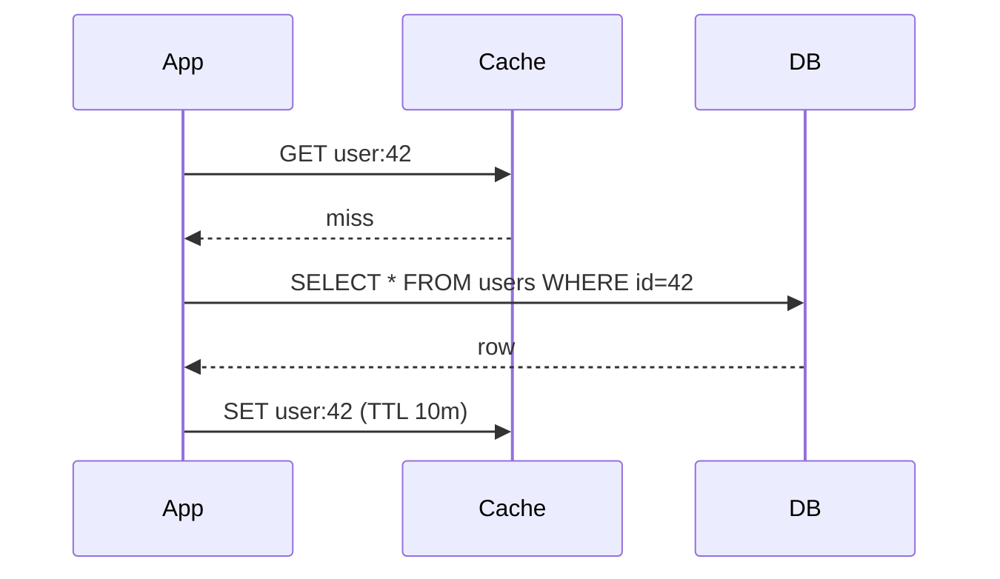

# 01. Caching patterns (cache-aside vs. write-through)

_Sent 2026-09-29_

A cache keeps hot data in fast memory (like Redis) so most reads skip the slow database. The hard part isn't adding a cache. It's deciding **who keeps the cache and the database in sync**, and that's where the patterns come in.

**Cache-aside (lazy loading)** is the most common. The app checks the cache first. On a miss, it reads the database, puts the result in the cache, and returns it. On a write, it updates the database and **deletes** the cache key, so the next read reloads fresh data.

**Write-through** puts the cache in the write path. Every write goes to the cache and the database together, so the cache is always warm and consistent. The catch is slower writes, plus the cache fills up with data nobody ever reads.

**In the real world:** Facebook's memcache paper describes cache-aside at huge scale. Their fix for the "thundering herd" was **leases**: when a hot key expires, only one request gets permission to rebuild it, so a million requests don't all hit MySQL at the same moment.

**Tradeoffs and gotchas**
- Delete on write, don't update. Two writers racing to update the cache can leave stale data sitting there with no end date.
- Always set a TTL (a time-to-live, meaning an expiry) as a safety net, because invalidation bugs happen.
- Watch out for a cache stampede when a hot key expires. Fix it with leases or locks, jittered TTLs, or refreshing popular keys early.
- A cold cache after a restart can flatten your database, so warm it up gradually.

**Try this:** A product page gets 50k reads per second and its price changes about once an hour. Which pattern would you pick, what TTL, and how would you make sure a price change shows up within 5 seconds?
