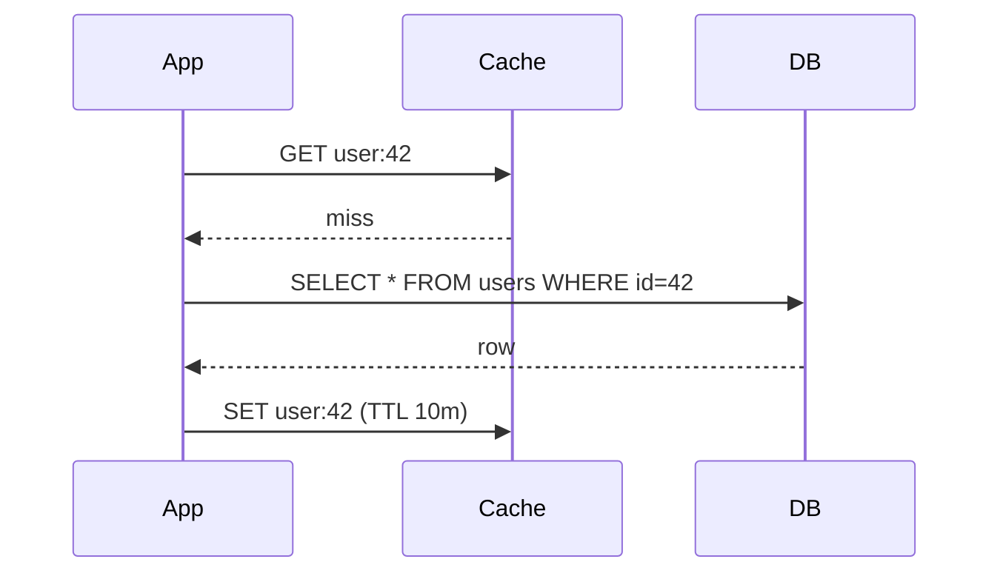

# 01. Caching patterns (cache-aside vs. write-through)

_Sent 2026-09-29_

A cache keeps hot data in fast memory (like Redis) so most reads skip the slow database. A database read from disk is often a few milliseconds; a hit in an in-memory cache on the same network is usually well under a millisecond. The hard part isn't adding a cache. It's deciding **who keeps the cache and the database in sync**, and that's where the patterns come in.

**Cache-aside (lazy loading)** is the most common. The app checks the cache first. On a miss, it reads the database, puts the result in the cache, and returns it. On a write, it updates the database and **deletes** the cache key, so the next read reloads fresh data. Note the cost asymmetry: a hit is one fast round trip, but a miss is a cache round trip *plus* a database query *plus* a write-back, so a low hit rate can be slower than no cache at all.

**Write-through** puts the cache in the write path. Every write goes to the cache and the database together, so the cache is always warm and consistent. The catch is slower writes, plus the cache fills up with data nobody ever reads. A related pattern, **write-back** (write-behind), updates the cache and flushes to the database later. It's faster still but can lose recent writes if a cache node dies, so it's rare for data you can't afford to lose.

**In the real world:** Facebook's memcache paper describes cache-aside at huge scale. Their fix for the "thundering herd" was **leases**: when a hot key expires, only one request gets permission to rebuild it, so a million requests don't all hit MySQL at the same moment.

**A second example:** Facebook's "An Analysis of Facebook Photo Caching" (SOSP 2013) traced 77.2 million photo requests over a month. The browser cache served about 65.5%, an edge cache another 20.0%, and an origin cache 4.6%, so only about 9.9% ever reached the Haystack backend. That's layered caching in a nutshell: each layer peels off most of what's left, hit rate falls as you go deeper (each layer only sees the misses above it), and the backend sees a tiny fraction of raw demand.

**Tradeoffs and gotchas**
- Delete on write, don't update. Two writers racing to update the cache can leave stale data sitting there with no end date.
- Always set a TTL (a time-to-live, meaning an expiry) as a safety net, because invalidation bugs happen. Twitter's cache study (OSDI 2020) found most of its clusters used short TTLs, with 66% under 12 hours. A short TTL bounds how wrong a stale entry can get.
- Watch out for a cache stampede when a hot key expires. Fix it with leases or locks, jittered TTLs, or refreshing popular keys early. At fleet scale this becomes (lesson 20)'s problem.
- A cold cache after a restart can flatten your database, so warm it up gradually.
- Don't assume a cache only serves reads. That same Twitter study found over a third of clusters were write-heavy.
- Eviction policy matters once memory fills. LRU (least recently used) is the common default, but the study found FIFO's miss ratio was close to LRU's at reasonable sizes while needing less bookkeeping.

**When to use, when not.** Reach for cache-aside when reads dominate and slightly stale data is fine (profiles, catalogs, rendered fragments), and write-through when the cache must stay warm and slower writes are acceptable. Skip caching when data changes on nearly every read, when strict freshness is required, or when the hit rate would be so low that misses dominate.

**Try this:** A product page gets 50k reads per second and its price changes about once an hour. Which pattern would you pick, what TTL, and how would you make sure a price change shows up within 5 seconds?
