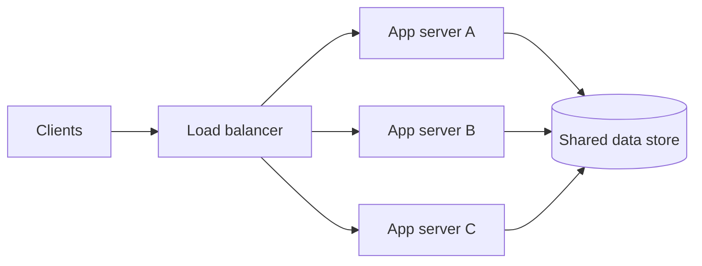

# 02. Load balancing

_Sent 2026-09-30_

Yesterday was caching, which keeps hot data close. Today's question: once you have more than one server, how do you spread traffic so no single machine becomes the bottleneck?

A load balancer sits in front of a pool of similar backends and picks which one handles each request. Clients talk to one address and the balancer spreads the work out. That gets you horizontal scaling, rolling deploys, and a way to quietly pull unhealthy instances out of rotation.

**L4 vs. L7**
- **L4 (transport layer)** routes on IP, port, and TCP. It's fast and cheap but can't see anything about HTTP, so it's a good fit for raw throughput and simple TCP services.
- **L7 (application layer)** understands HTTP: paths, hosts, headers, cookies. It can do sticky sessions, path-based routing (`/api` vs. `/static`), and TLS termination. It costs a bit more CPU and gives you far more control.

**How it picks a backend**
- **Round-robin** just cycles through the list. That's fine when every request costs about the same.
- **Least connections** sends each request to whichever server is least busy. It works better when some connections are long-lived, like WebSockets or big uploads.
- **Consistent hashing** sends the same key (a user id or cache key) to the same node almost every time. It's useful when backends hold local state, and when one node dies only its own keys move instead of the whole pool reshuffling.

Always pair routing with **health checks**. If a node fails and stays in the pool, one failure quickly spreads into many.

**In the real world:** AWS's ALB (L7) and NLB (L4), nginx, Envoy, or HAProxy in front of app fleets, Kubernetes Services and Ingress, and Cloudflare doing global load balancing at the edge. A common layout uses DNS or a CDN to route users by geography, then an L7 balancer in each region in front of autoscaled app servers.

**Tradeoffs and gotchas**
- The balancer is itself a single point of failure unless you run it highly available, across multiple zones or as a managed cloud service.
- Sticky sessions work against clean horizontal scaling, so use a shared session store when you can.
- Health checks that are too aggressive make instances flap in and out. Checks that are too slow keep sending traffic to dead servers.
- When the balancer terminates TLS, it sees plaintext unless you re-encrypt traffic to the backends, so know where your trust boundary is.
- A recovering node can get flooded the moment it rejoins and fall over again. Connection draining and slow-start fix this.

**Try this:** You're putting a load balancer in front of 20 API servers. Most requests are short JSON GETs, but 5% open a WebSocket that stays connected for hours. Which algorithm do you pick, and do you keep the WebSockets in the same pool as the GETs or split them out? Why?
