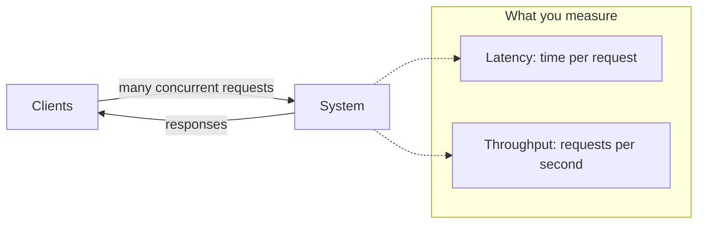

# 03. Latency vs. throughput

_Sent 2026-10-01_

Latency is how long one request takes. Throughput is how many requests the system finishes per second. They sound like the same thing, but improving one can hurt the other, and a lot of production arguments start because someone optimized the wrong one.

**Why it matters:** teams talk past each other. Product wants "the app feels fast," which is latency. Ops wants "we survive Black Friday," which is throughput. They're looking at the same dashboard with different goals, and saying out loud which one you're chasing changes the design.

The useful mental model here is **Little's Law**, which says the amount of work in flight equals throughput times latency:

$$ L = \lambda \times W $$

Here \( L \) is concurrent requests, \( \lambda \) is throughput, and \( W \) is latency. If concurrency stays fixed and you cut latency, throughput goes up. If you pile on more parallel work than you have capacity for, latency climbs even while average throughput still looks fine.

**In the real world:** streaming services like Netflix care about both, on different paths. Starting playback is a latency problem, because people give up if the first frame is slow. Serving millions of concurrent streams is a throughput problem, because the CDN and origin servers have to push an enormous amount of total bandwidth. A path tuned only for peak requests per second can still feel broken if its slowest 1% of requests (the p99) spike.

**Tradeoffs and gotchas**
- Averages lie. A 50 ms mean with a 5-second p99 feels broken to real users, so always look at percentiles under load.
- Batching and queues raise throughput by spreading fixed costs across many items, but each item waits longer, so its latency gets worse.
- More parallelism raises throughput until you hit a contended lock, a hot shard, or an exhausted thread pool. After that, throughput flattens while latency shoots up.
- Making every call async often adds capacity, but scheduling and fan-out add tail latency.

**Try this:** An API has to stay under 200 ms at p99 for interactive reads, and it also has to absorb a 10x traffic spike during a launch. Do you fix the read path's slow dependencies first (latency) or the autoscaling and load shedding first (throughput)? Which metrics would tell you which one is actually on fire?
