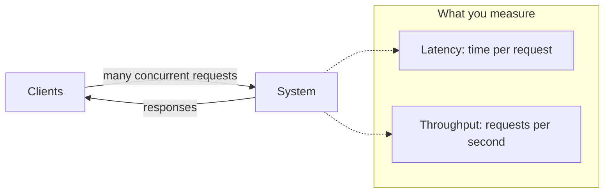

# 03. Latency vs. throughput

_Sent 2026-10-01_

Latency is how long one request takes. Throughput is how many requests the system finishes per second. They sound like the same thing, but improving one can hurt the other, and a lot of production arguments start because someone optimized the wrong one.

**Why it matters:** teams talk past each other. Product wants "the app feels fast," which is latency. Ops wants "we survive Black Friday," which is throughput. They're looking at the same dashboard with different goals, and saying out loud which one you're chasing changes the design.

The useful mental model here is **Little's Law**, which says the amount of work in flight equals throughput times latency:

$$ L = \lambda \times W $$

Here \( L \) is concurrent requests, \( \lambda \) is throughput, and \( W \) is latency. A worked example: if each request takes 20 ms (\( W = 0.02 \) s) and you want 10,000 requests per second, you need \( L = 10{,}000 \times 0.02 = 200 \) requests in flight at once, so roughly 200 units of concurrency (threads, connections, or async slots). If latency doubles to 40 ms and concurrency is capped at 200, throughput halves to 5,000. That single equation explains most capacity surprises.

**In the real world:** streaming services like Netflix care about both, on different paths. Starting playback is a latency problem, because people give up if the first frame is slow. Serving millions of concurrent streams is a throughput problem, because the CDN and origin servers have to push an enormous amount of total bandwidth. A path tuned only for peak requests per second can still feel broken if its slowest 1% of requests (the p99) spike.

**A second example: the tail is the system.** In "The Tail at Scale" (Dean and Barroso, 2013), a request that fans out to many servers is as slow as its slowest piece. If one server has a 99th-percentile latency of one second, a request touching 100 of them will almost always hit at least one slow server. Their fix is the **hedged request**: after waiting the 95th-percentile expected time, send a duplicate to another replica and take whichever answers first. In a Google benchmark reading 1,000 keys from a BigTable spread over 100 servers, hedging after a 10 ms delay cut the 99.9th-percentile time to read all 1,000 values from 1,800 ms to 74 ms, while sending only about 2% more requests. Tail latency, not the average, is what fan-out systems live and die by.

**Tradeoffs and gotchas**
- Averages lie. A 50 ms mean with a 5-second p99 feels broken to real users, so always look at percentiles under load.
- Batching and queues raise throughput by spreading fixed costs across many items, but each item waits longer, so its latency gets worse.
- More parallelism raises throughput until you hit a contended lock, a hot shard, or an exhausted thread pool. After that, throughput flattens while latency shoots up (the knee of the curve).
- Making every call async often adds capacity, but scheduling and fan-out add tail latency.
- Hedging and retries buy tail latency with extra load, so they only work when the slow replica's trouble is independent, not when every replica is overloaded at once.
- Watch goodput, not just throughput: requests that finish after the client gave up are wasted work (lesson 30).

**When to use which lens.** Optimize latency when a human is waiting on each request (page loads, autocomplete, checkout), and throughput when work is batched or queued and total completion rate is what matters (ingest pipelines, analytics, transcoding). Most real systems need both, measured separately per path.

**Try this:** An API has to stay under 200 ms at p99 for interactive reads, and it also has to absorb a 10x traffic spike during a launch. Do you fix the read path's slow dependencies first (latency) or the autoscaling and load shedding first (throughput)? Which metrics would tell you which one is actually on fire?
