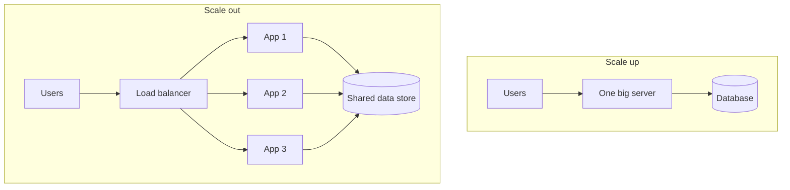

# 04. Vertical vs. horizontal scaling

_Sent 2026-10-03_

Your app is getting popular and one machine can't keep up. You can make that machine bigger, or you can add more machines. Those solve different problems, and mixing them up is a classic mistake in interviews and in production.

**Vertical scaling (scaling up)** means giving one server more CPU, RAM, or faster disks. It's simple: no code changes and none of the headaches that come with distributed systems. But the ceiling is hard. There's a biggest machine you can buy, and when it fails, everything fails with it.

**Horizontal scaling (scaling out)** means running many smaller instances behind a load balancer and spreading traffic across them. Capacity grows as you add instances, and one machine dying is usually fine. The catch is that your design has to allow it.

What makes horizontal scaling possible is **stateless app servers**. Any instance can handle any request because sessions and other lasting state live in Redis, a database, or object storage, not in the server's own memory. Sticky sessions, which pin each user to one server, are a temporary crutch: they make failover and autoscaling awkward.

**In the real world:** early Twitter was famous for the "fail whale" error page, because its tightly coupled monolith couldn't absorb traffic spikes. The rebuild split it into many independent services that scale out separately. Netflix runs the same idea at huge scale, with thousands of identical instances that come and go with demand while state lives in databases and caches.

**Tradeoffs and gotchas**
- Vertical scaling is quick to adopt and easy to reason about, until you hit the hardware ceiling or one machine's outage takes everything down.
- Horizontal scaling needs a load balancer, health checks, and shared state. That's more moving parts, plus distributed failure modes like partial outages and request floods when new instances come up.
- Scaling the app tier doesn't help if the database is still one overloaded primary. That's when you reach for read replicas, sharding, or caching.
- Cost isn't always linear. Many small instances can beat one giant machine on both price and availability, but only if your deployment and operations tooling is solid.

**Try this:** An API handles about 2,000 requests per second, each user's session takes about 50 MB in the server's memory, and p99 latency keeps climbing under load. Do you scale up first, scale out first, or change the design before adding capacity? What's the one change that sets you up best long term?
