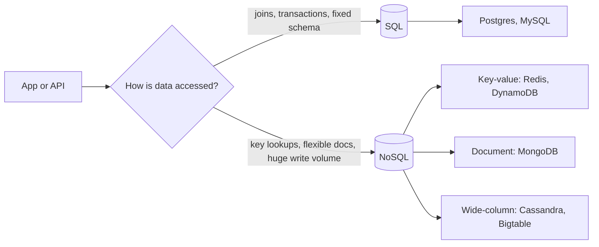

# 05. SQL vs. NoSQL, picking a data store

_Sent 2026-10-04_

Once your app servers scale out, the database is usually the next bottleneck. The first decision isn't which vendor to use. It's whether the way you read and write data suits a **relational (SQL)** store or a **non-relational (NoSQL)** one.

**Why it matters:** SQL databases assume structured rows, relationships between tables, and strong guarantees for every transaction. NoSQL databases give up one or more of those (a fixed schema, joins, or full transactions) in exchange for easier scaling, flexible documents, or very fast lookups by key. Pick wrong and you either fight the data model every sprint or pay for consistency you don't need.

**SQL** gives you tables, foreign keys, joins, schemas, and ACID transactions, which means a group of changes either all succeeds or all fails. It shines when correctness across several rows matters, like committing an order, an inventory change, and a payment together.

**The common NoSQL families**
- **Key-value** stores get and set values by key. They're very fast for sessions, caches, and feature flags.
- **Document** stores hold JSON-like documents with flexible fields, which works well for user profiles and content.
- **Wide-column** stores hold rows with many sparse columns. They're built for massive write volume and time-ordered data.

**In the real world:** Shopify keeps its core commerce data (orders, inventory, payments) in MySQL, because a checkout that sells the same item twice is unacceptable and you want multi-row transactions. Netflix leans heavily on Cassandra for viewing history: huge write volume, looked up mostly by user, and the product can tolerate a few seconds of staleness. Most big companies use both, relational for money and identity and NoSQL for high-volume data looked up by key.

**Tradeoffs and gotchas**
- SQL gives you joins, constraints, mature tooling, and strong consistency. The downside is that a single primary eventually hits hardware limits, sharding is hard, and schema migrations get painful at size.
- NoSQL gives you easy horizontal scaling, flexible schemas, and simple key lookups. The downside is that you end up rebuilding joins and transactions in app code, eventual consistency shows up as odd UI states, and a query that scans everything will hurt.
- Two classic mistakes: putting highly relational data in MongoDB "because NoSQL scales" and then writing joins across three collections in the app, or using Postgres as a high-volume queue or cache and wondering why p99 is awful under load.

**Try this:** You're designing a multiplayer game leaderboard with millions of score updates per minute, reads for "top 100" and "my rank," and occasional admin corrections. Do you put the hot path in SQL, in a key-value store with sorted sets like Redis, or both? What would each layer own?
