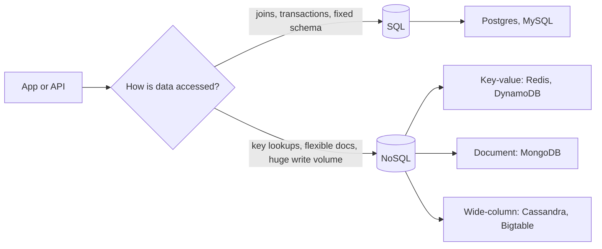

# 05. SQL vs. NoSQL, picking a data store

_Sent 2026-10-04_

Once your app servers scale out, the database is usually the next bottleneck. The first decision isn't which vendor to use. It's whether the way you read and write data suits a **relational (SQL)** store or a **non-relational (NoSQL)** one.

**Why it matters:** SQL databases assume structured rows, relationships between tables, and strong guarantees for every transaction. NoSQL databases give up one or more of those (a fixed schema, joins, or full transactions) in exchange for easier scaling, flexible documents, or very fast lookups by key. Pick wrong and you either fight the data model every sprint or pay for consistency you don't need.

**SQL** gives you tables, foreign keys, joins, schemas, and ACID transactions, which means a group of changes either all succeeds or all fails. It shines when correctness across several rows matters, like committing an order, an inventory change, and a payment together.

**The common NoSQL families**
- **Key-value** stores get and set values by key. They're very fast for sessions, caches, and feature flags.
- **Document** stores hold JSON-like documents with flexible fields, which works well for user profiles and content.
- **Wide-column** stores hold rows with many sparse columns, organized as partition key plus clustering (sort) key. They're built for massive write volume and time-ordered data.

The deciding question is almost always **your access pattern**, not the data itself. SQL lets you query data many ways after the fact with joins and ad-hoc `WHERE` clauses. NoSQL asks you to know your queries up front and model the data to match them, because a query that doesn't hit the partition key has to scan everything.

**In the real world:** Shopify keeps its core commerce data (orders, inventory, payments) in MySQL, because a checkout that sells the same item twice is unacceptable and you want multi-row transactions. Netflix leans heavily on Cassandra for viewing history: huge write volume, looked up mostly by user, and the product can tolerate a few seconds of staleness. Most big companies use both: relational for money and identity, NoSQL for high-volume data looked up by key.

**A second example: Discord's move to wide-column.** Discord started on MongoDB, but by late 2015, around 100 million messages, a single collection indexed on `(channel_id, created_at)` could no longer keep the working set in memory and random reads thrashed the disk cache. In 2017 they wrote about migrating messages to Cassandra. They made `channel_id` the partition key and the Snowflake `message_id` the clustering key, then added a 10-day time **bucket** to the partition key so one busy channel's partition stayed under Cassandra's roughly 100 MB comfort threshold. It's a clean illustration of NoSQL data modeling: pick the key so your common query ("recent messages in this channel") is one contiguous range read, and bound partition growth on purpose.

**Tradeoffs and gotchas**
- SQL gives you joins, constraints, mature tooling, and strong consistency. The downside is that a single primary eventually hits hardware limits, sharding is hard, and schema migrations get painful at size.
- NoSQL gives you easy horizontal scaling, flexible schemas, and simple key lookups. The downside is that you end up rebuilding joins and transactions in app code, eventual consistency shows up as odd UI states, and a query that scans everything will hurt.
- Unbounded partitions are a classic NoSQL trap. A key that grows forever (all of one channel's messages, all of one tenant's events) becomes a hot, oversized partition; bucket it by time or size.
- "NoSQL has no transactions" is dated. DynamoDB, MongoDB, and others added limited multi-item transactions, but they're narrower and costlier than a relational `BEGIN ... COMMIT`, so don't lean on them as if they were free.
- Two classic mistakes: putting highly relational data in MongoDB "because NoSQL scales" and then writing joins across three collections in the app, or using Postgres as a high-volume queue or cache and wondering why p99 is awful under load.

**When to use which.** Default to SQL: it's flexible, correct, and good enough well past most startups' scale, and a single Postgres box handles a lot. Reach for NoSQL when you have a clear, narrow access pattern at a scale or write rate that outgrows one primary (time-series, messages, events, huge key-value lookups), or when a flexible schema genuinely matters. Using both, each for what it's good at, is the common end state.

**Try this:** You're designing a multiplayer game leaderboard with millions of score updates per minute, reads for "top 100" and "my rank," and occasional admin corrections. Do you put the hot path in SQL, in a key-value store with sorted sets like Redis, or both? What would each layer own?
