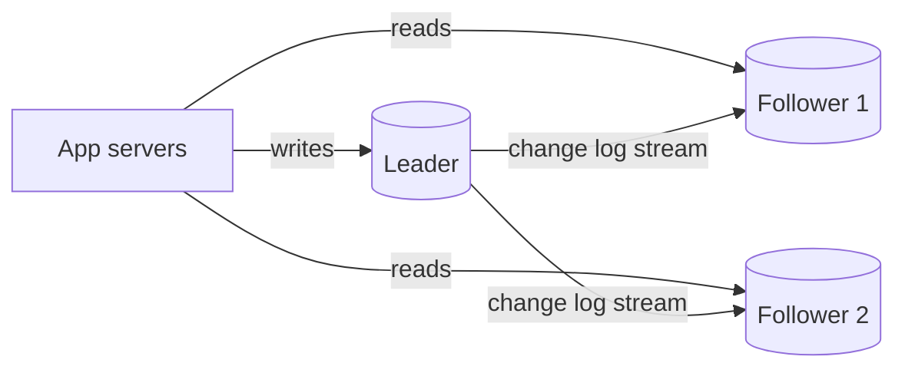

# 06. Database replication — copies are easy, agreement is hard

_Sent 2026-10-05_

Yesterday we picked a database. Today we keep it alive. Replication means keeping copies of the same data on several machines. It gets you three things: you survive a node dying (availability), you can spread reads across copies (read scale), and you can put data closer to users (latency). The catch is that copies drift apart, and every design choice here is really a choice about how much drift you'll put up with.

**The default: leader-follower**

One node (the leader, or primary) takes every write. It streams its change log (the WAL in Postgres, the binlog in MySQL) to followers, and they replay it. Reads can go to any of them.

The big decision is when the leader tells the client a write is done:

- **Synchronous:** it waits until a follower confirms. No data is lost if the leader dies, but every write pays a network round trip, and one slow follower stalls all writes.
- **Asynchronous:** it confirms right away and ships the change later. Writes are fast, but if the leader dies, whatever hadn't shipped yet is gone.
- **Semi-synchronous:** it waits for at least one follower and lets the rest catch up async. This is the usual production compromise, and it's roughly what MySQL semi-sync and Postgres `synchronous_standby_names` give you.

**Replication lag is where the bugs live**

With async followers, a read can hit a copy that's a few milliseconds behind, or a few minutes behind under load. The classic bug: a user saves their profile, the page reloads from a follower, and their change seems to have vanished. The fixes are cheap if you plan for them. You can route a user's reads to the leader for a short window after they write (read-your-writes), pin each user to one follower so time never appears to run backward for them (monotonic reads), or track the log position of a write and only read from followers that have caught up to it.

**In the real world: GitHub, October 2018**

A network glitch of about 43 seconds cut GitHub's US East Coast data center off from its main network. Their automated failover tool promoted MySQL replicas on the West Coast to leader. When the link came back, both coasts had accepted writes the other side didn't have. Undoing that by hand, without losing anyone's data, left GitHub degraded for about 24 hours. The lesson: automatic failover plus async replication can turn a short blip into a long, painful cleanup. Their [incident write-up](https://github.blog/news-insights/company-news/oct21-post-incident-analysis/) is well worth reading.

**Tradeoffs and failure modes**

- **Failover is the hard part, not replication.** You need to detect that the leader is really dead and not just slow, pick the most up-to-date follower, and make sure the old leader can't come back still thinking it's in charge. If two nodes both believe they're the leader, that's called split brain. The usual guard is fencing, which means revoking the old leader's right to accept writes, often with an incrementing epoch number.
- **Async failover loses writes.** That's fine for likes and view counts, not fine for payments. Pick per dataset, not per company.
- **Read replicas don't scale writes.** Every follower replays every write. If writes are your bottleneck, you need sharding (coming soon).
- **Multi-leader** (writes accepted in several regions) cuts write latency for global users, but you now have to resolve conflicting writes. Last-write-wins quietly drops data.
- **Leaderless** (Dynamo, Cassandra) has clients write to and read from several replicas, with quorums like W + R > N. It's very available, but you're signing up for eventual consistency and repair work.

**Try this**

You run a banking app. Balances live in Postgres in us-east-1, with async read replicas in us-east-1 and eu-west-1. A user in Paris transfers money and immediately refreshes their balance. What could go wrong, and where should that refresh read from? Then, separately, if us-east-1 goes down, would you auto-promote the EU replica? What would you have to accept to do that?
