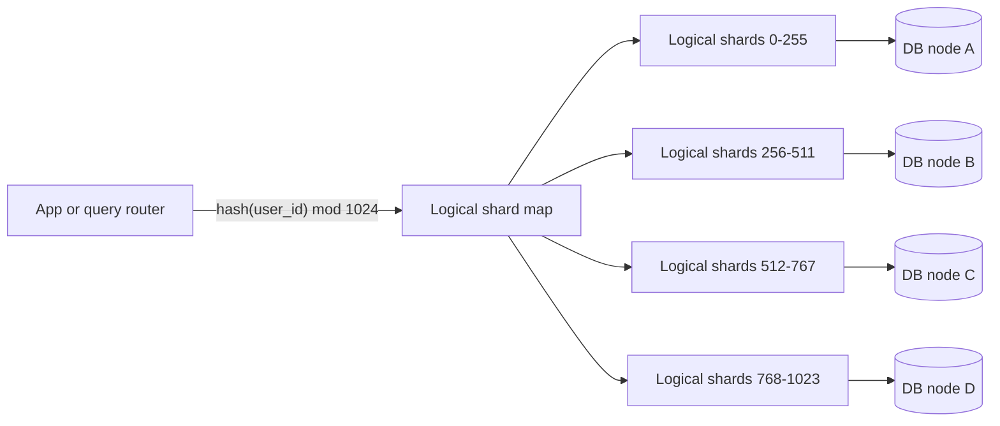

# 07. Sharding, or splitting one database into many

_Sent 2026-10-06_

Yesterday's lesson on replication copied the same data onto several machines. That helps with reads and failover, but every copy still holds *all* the data, and the leader still takes *every* write. Once your data or write volume outgrows the biggest machine you can buy, you need **sharding**: splitting the data so each node owns only a slice of it.

A **shard key** decides where each row goes. A good key spreads load evenly and keeps most queries on a single shard. A bad key gives you a distributed system that's slower than the one machine you started with.

**Three ways to route rows to shards**
- **Hash sharding** hashes the key and maps the result to a shard. Load spreads evenly, but a range query like "orders from last week" has to hit every shard.
- **Range sharding** gives each shard a continuous span of keys, like A to F or a block of dates. Range queries are great, but keys that keep increasing, like timestamps or auto-increment IDs, pile every new write onto the last shard.
- **Directory sharding** keeps a lookup table that maps each key to its shard. It's the most flexible, since you can move any tenant anywhere, but that lookup table becomes something you have to keep fast and always available.

The trick that saves you later is **logical shards**. Split the data into far more shards than you have machines, say 1,024 shards on 4 nodes. When you need more capacity, you move whole logical shards to new machines and never rehash individual rows.

**In the real world:** Instagram's 2012 engineering blog post describes how they sharded PostgreSQL. They created thousands of logical shards, each one a Postgres schema, and spread them across a much smaller number of physical servers. As they grew, they moved logical shards to new hardware without re-splitting any data. They also built the shard ID into every 64-bit object ID: 41 bits of timestamp, 13 bits of shard ID, and 10 bits of sequence number. Any ID tells you which shard it lives on without a lookup, and IDs still sort roughly by time.

**Tradeoffs and gotchas**
- **Hot spots.** Even a perfect hash can't split a single key. If you shard by `user_id`, a celebrity with 100 million followers still lives on one shard. You can split that key further (for example, `user_id` plus a bucket number), handle the heaviest users specially, or put a cache in front of them.
- **Cross-shard queries.** Any query without the shard key has to fan out to every shard and gather the results. Your p99 is then set by the slowest shard, which is the tail-latency problem from Lesson 3 coming back.
- **Cross-shard transactions.** Joins and ACID guarantees mostly stop at the shard boundary. Either design so related data shares a shard key (all of a customer's orders live with that customer), or take on two-phase commit or sagas.
- **Resharding.** With plain `hash mod N`, changing N moves almost every key. Consistent hashing (from Lesson 2) or logical shards keep that movement small, but migrating data while the system is live is still one of the riskiest things a team does.
- **Sharding too early** means paying the complexity cost for nothing. Try scaling up, read replicas, caching, and archiving old data first.

**Try this:** You're building a multi-tenant SaaS app. Most tenants are small, but three enterprise customers each generate 30% of all writes. Do you shard by `tenant_id`, by `user_id`, or by something else? How do you keep those three from overwhelming their shards, and what happens to your "usage across all tenants this month" admin report?
