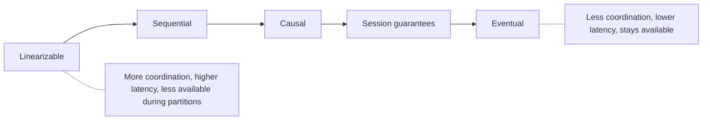

# 08. Consistency models, or what a read actually promises

_Sent 2026-10-07_

Over the last two lessons we copied data onto replicas and split it across shards. That leaves a question every distributed store has to answer: if I write `x = 5` on one node and you read `x` from another node right after, what are you allowed to see? A consistency model is the promise that answers it. The stronger the promise, the more the nodes have to coordinate, and coordination costs you latency and availability.

**The spectrum, strongest to weakest**
- **Linearizable (strong):** the system behaves as if there's only one copy of the data. Once a write finishes, every later read sees it, no matter which node answers. You need this for locks, leader election, and "only one person gets the last seat."
- **Sequential:** everyone sees operations in the same order, but that order doesn't have to match real time. Products rarely advertise it. It mostly comes up in theory.
- **Causal:** if one operation could have influenced another (I post, then you reply), everyone sees them in that order. Unrelated writes can show up in different orders on different nodes, but you never see a reply before the post it answers.
- **Session guarantees:** promises that apply to a single client. *Read-your-writes* means you always see your own updates. *Monotonic reads* means a later read never shows you older data than an earlier one did. These are cheap, and they fix most of the bugs users actually notice.
- **Eventual:** once writes stop, the replicas end up agreeing. It promises nothing about what you see in the meantime.

**CAP is the famous one, PACELC is the more useful one**

CAP says that during a network **p**artition you have to choose between **c**onsistency (refuse or block requests) and **a**vailability (answer, possibly with stale data). That's true, but partitions are rare. PACELC adds the trade you make every day: **e**lse, when there's no partition, you're still choosing between **l**atency and **c**onsistency, because a strong read has to ask a leader or a quorum instead of the nearest replica.

Leaderless stores like Dynamo and Cassandra let you set this with quorums. With \( N \) replicas, a write waits for \( W \) acknowledgements and a read asks \( R \) nodes. If

$$ R + W > N $$

then every group you read from overlaps with the latest group that took the write, so you see the newest value (unless you're using sloppy quorums or writes happen at the same moment). With \( N=3 \), \( W=2 \), \( R=2 \) you get that overlap. \( W=1 \), \( R=1 \) is fast but only eventual.

**In the real world:** DynamoDB lets you choose per request. Reads are eventually consistent by default. Setting `ConsistentRead=true` makes it a strong read, which costs twice the read capacity and isn't available on global secondary indexes. So teams use strong reads only on paths like "check the balance before a debit" and leave everything else cheap.

Amazon S3 was eventually consistent for overwrites and deletes for about 14 years. You could upload a new version of a file and still download the old one. Data pipelines built on Hadoop and Spark needed workarounds like EMRFS consistent view and S3Guard. In December 2020, AWS made S3 strongly consistent after writes at no extra cost, and a lot of that workaround code just went away. It's a good reminder that a weak promise pushes complexity onto every client.

**Tradeoffs and gotchas**
- **Stronger isn't free.** Linearizable reads in Spanner, etcd, or ZooKeeper need a round trip to a leader or quorum, often across regions, and they stall if you lose a majority of nodes.
- **Bugs from eventual consistency look like ghosts.** Someone updates their profile, refreshes, and sees the old one. A deleted item comes back. An inventory count goes negative. These almost never show up in tests, only under real load with replication lag.
- **Mix models on purpose.** Most real systems keep a small core strongly consistent (money, uniqueness, locks) and use causal, session, or eventual consistency for everything else (feeds, counters, recommendations).
- **Weaker models leave you resolving conflicts.** When two writes happen at once, something has to pick a winner. Last-write-wins quietly throws data away, and CRDTs or custom merge logic take real work.

**Try this:** You're designing a collaborative to-do app with four pieces: the list of items, a "completed" checkbox on each item, a per-user "unread changes" badge, and billing seats for the workspace, where a plan allows at most 10 members. Pick a consistency model for each and explain why. Where is eventual fine, where do session guarantees cover it, and which one has to be linearizable?
