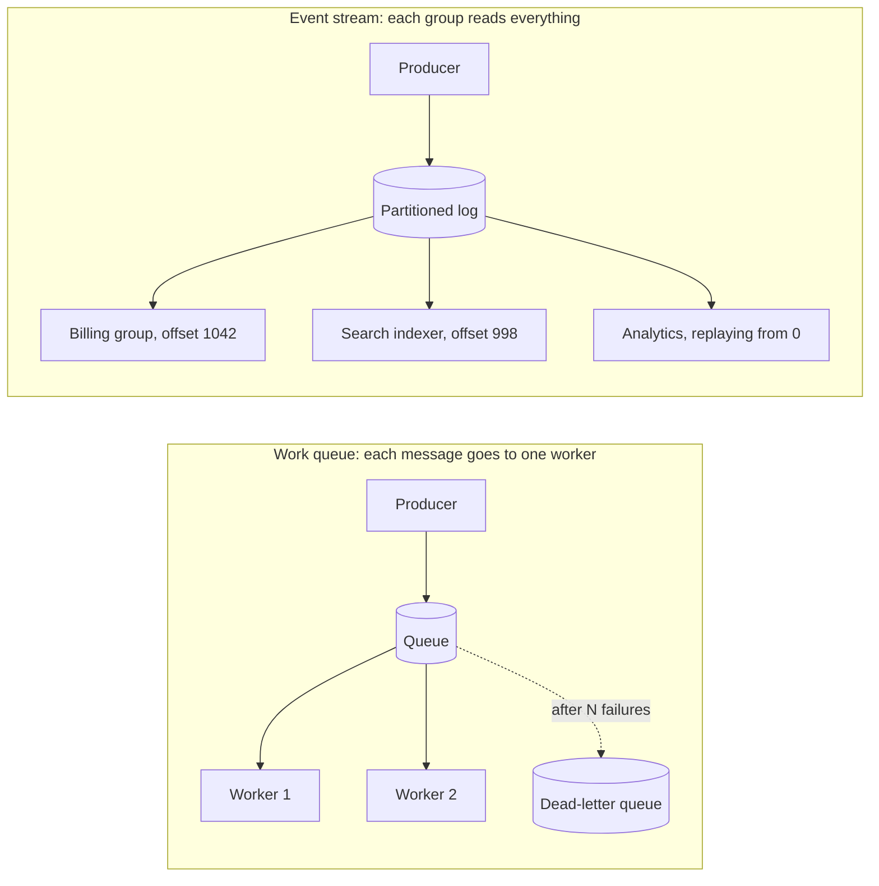

# 09. Message queues vs. event streams

_Sent 2026-10-08_

When service A calls service B directly, A inherits B's latency and B's outages, and any traffic spike on A hits B at full force. A message broker in between decouples them. The producer writes a message and moves on, and the consumer works through messages at its own pace. The catch is that "a broker" covers two quite different designs, and picking the wrong one is a common mistake.

**A work queue** (SQS, RabbitMQ) treats each message as a task. One consumer takes it, processes it, and acknowledges it, and then it's gone. You scale by adding more consumers that compete for messages. If a consumer dies before acknowledging, the message becomes visible again after a timeout and another consumer picks it up.

**An event stream** (Kafka, Kinesis) is an append-only log that keeps messages for a set retention period, whether or not anyone has read them. Each consumer group tracks its own position in the log, called an offset. That way billing, search indexing, and analytics can all read the same events independently, and any of them can rewind and replay. Ordering is only guaranteed within a partition, and a group can't run more consumers in parallel than there are partitions.

A rough rule: if the message means "please do this," use a queue. If it means "this happened," use a stream.

**How a stream actually tracks progress.** The log is split into partitions, each an ordered sequence of records numbered by offset. A consumer group assigns each partition to one consumer in the group, and each consumer periodically **commits** the offset it has processed. On restart or rebalance it resumes from the last committed offset. Commit *after* processing and you get at-least-once (a crash between processing and commit replays the record); commit *before* and you get at-most-once (a crash loses it). That one ordering choice is where most duplicate-or-loss behavior comes from.

**Delivery guarantees.** At-most-once means you can lose messages. At-least-once is the practical default, and it means you'll get duplicates. In real systems, "exactly-once" is really at-least-once delivery plus consumers that can safely handle the same message twice. Kafka's transactions give you exactly-once when you read, process, and write back within Kafka. As soon as you call an outside service like a payment provider, deduplication is your job again. That's the idempotency lesson (lesson 11), coming up soon.

**In the real world:** LinkedIn built Kafka around 2010 and open-sourced it in 2011. Before that, every system producing data was wired separately to every system that needed it. Replacing that tangle with one durable log that everyone publishes to and reads from turned N×M custom integrations into N+M. Jay Kreps' essay [The Log](https://engineering.linkedin.com/distributed-systems/log-what-every-software-engineer-should-know-about-real-time-datas-unifying) explains the reasoning and is worth a read.

**A second example: Uber's retry topics (2018).** Uber wrote about "Building Reliable Reprocessing and Dead Letter Queues with Apache Kafka." Because a stream is strictly ordered per partition, a single message that keeps failing would block everything behind it. Their fix was separate **retry topics**: a failed message is republished to retry-level-1, then retry-level-2, and so on, each level adding a longer delay, and the consumer commits the original offset immediately so live traffic keeps flowing. A message that exhausts all retry levels lands in a **dead-letter topic** for humans to inspect and optionally replay. It's a clean pattern for keeping a stream's ordering benefits without letting one poison message stall the pipeline.

**Tradeoffs and gotchas**
- **A backlog hides outages.** The producer looks healthy while consumers quietly fall hours behind. Alert on consumer lag and the age of the oldest unprocessed message, not just on errors.
- **Poison messages.** A message that always crashes the consumer gets retried forever, and on a stream it also blocks everything behind it in that partition. Cap retries and send failures to a dead-letter queue, or use retry topics as above.
- **Ordering vs. parallelism.** Keeping each key's events in order means partitioning by key, and that brings back the hot-key problem from sharding: one busy customer ties up one partition (lesson 37). Your maximum consumer parallelism is capped at the partition count, so pick it with growth in mind.
- **The dual-write trap.** "Write to the database, then publish the event" breaks if you crash between the two steps. The usual fix is a transactional outbox (lesson 33): you write the event into an outbox table in the same database transaction, and a separate relay or change-data-capture process publishes it.
- **Rebalancing pauses.** When consumers join or leave a Kafka group, partitions get reassigned, and consumption can stop briefly.
- **Retention vs. cost.** A stream's superpower, replay, costs disk. Keeping 30 days of a high-volume topic is real money, so size retention to your actual replay needs.

**When to use which.** Use a queue for task distribution where each item is processed once by one worker and you want to scale workers independently (image resizing, email sending, webhooks). Use a stream when multiple independent consumers need the same events, when you want replay or an audit log, or when order per key matters. When in doubt, "please do this" is a queue and "this happened" is a stream, and plenty of systems run both.

**Try this:** An "order placed" event has to trigger four things: charge the card, decrement inventory, send a confirmation email, and update analytics. Which belong on a queue and which on a stream, and what's your partition key? Then the hard part: a consumer charges the card and crashes before saving its offset. What stops the customer from being charged twice?
