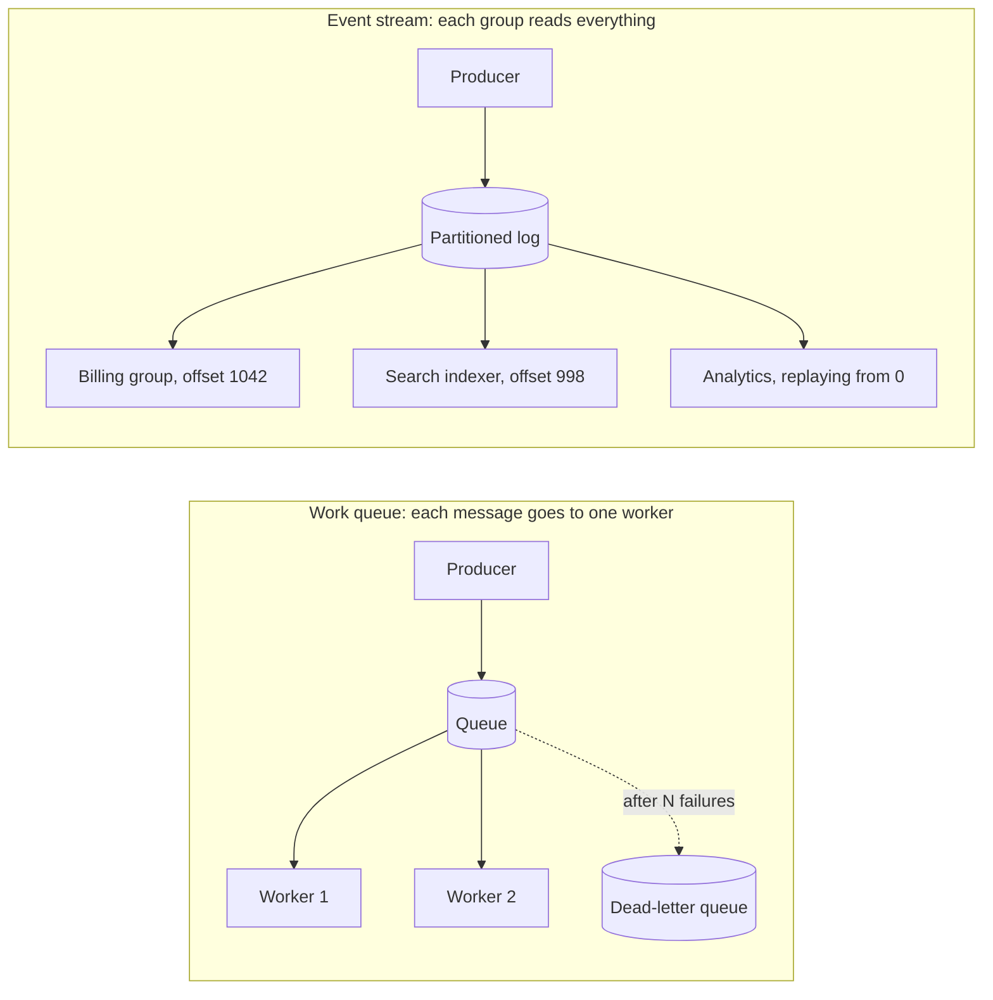

# 09. Message queues vs. event streams

_Sent 2026-10-08_

When service A calls service B directly, A inherits B's latency and B's outages, and any traffic spike on A hits B at full force. A message broker in between decouples them. The producer writes a message and moves on, and the consumer works through messages at its own pace. The catch is that "a broker" covers two quite different designs, and picking the wrong one is a common mistake.

**A work queue** (SQS, RabbitMQ) treats each message as a task. One consumer takes it, processes it, and acknowledges it, and then it's gone. You scale by adding more consumers that compete for messages. If a consumer dies before acknowledging, the message becomes visible again after a timeout and another consumer picks it up.

**An event stream** (Kafka, Kinesis) is an append-only log that keeps messages for a set retention period, whether or not anyone has read them. Each consumer group tracks its own position in the log, called an offset. That way billing, search indexing, and analytics can all read the same events independently, and any of them can rewind and replay. Ordering is only guaranteed within a partition, and a group can't run more consumers in parallel than there are partitions.

A rough rule: if the message means "please do this," use a queue. If it means "this happened," use a stream.

**Delivery guarantees.** At-most-once means you can lose messages. At-least-once is the practical default, and it means you'll get duplicates. In real systems, "exactly-once" is really at-least-once delivery plus consumers that can safely handle the same message twice. Kafka's transactions give you exactly-once when you read, process, and write back within Kafka. As soon as you call an outside service like a payment provider, deduplication is your job again. That's the idempotency lesson, coming up soon.

**In the real world:** LinkedIn built Kafka around 2010 and open-sourced it in 2011. Before that, every system producing data was wired separately to every system that needed it. Replacing that tangle with one durable log that everyone publishes to and reads from turned N×M custom integrations into N+M. Jay Kreps' essay [The Log](https://engineering.linkedin.com/distributed-systems/log-what-every-software-engineer-should-know-about-real-time-datas-unifying) explains the reasoning and is worth a read.

**Tradeoffs and gotchas**
- **A backlog hides outages.** The producer looks healthy while consumers quietly fall hours behind. Alert on consumer lag and the age of the oldest unprocessed message, not just on errors.
- **Poison messages.** A message that always crashes the consumer gets retried forever, and on a stream it also blocks everything behind it in that partition. Cap retries and send failures to a dead-letter queue.
- **Ordering vs. parallelism.** Keeping each key's events in order means partitioning by key, and that brings back the hot-key problem from sharding: one busy customer ties up one partition.
- **The dual-write trap.** "Write to the database, then publish the event" breaks if you crash between the two steps. The usual fix is a transactional outbox. You write the event into an outbox table in the same database transaction, and a separate relay or change-data-capture process publishes it.
- **Rebalancing pauses.** When consumers join or leave a Kafka group, partitions get reassigned, and consumption can stop briefly.

**Try this:** An "order placed" event has to trigger four things: charge the card, decrement inventory, send a confirmation email, and update analytics. Which belong on a queue and which on a stream, and what's your partition key? Then the hard part: a consumer charges the card and crashes before saving its offset. What stops the customer from being charged twice?
