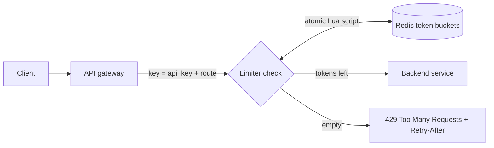

# 10. Rate limiting

_Sent 2026-10-09_

Every shared system has a limited budget of CPU, database connections, and quota from the services it calls. Rate limiting caps how fast any one caller can use up that budget. It protects you from abuse like scrapers and credential stuffing, from accidents like a customer's retry loop running wild, and from one noisy tenant starving everyone else. The real design questions are which algorithm to use, what to key the limit on, and where the counter lives.

**The algorithms**
- **Fixed window** counts requests per key in time buckets, like 12:00 to 12:01, and rejects anything past N. It's dead simple (`INCR` plus `EXPIRE` in Redis), but a caller can fit 2N requests into a short burst around the window boundary.
- **Sliding window log** stores a timestamp for each request and counts the ones from the last 60 seconds. It's exact, but memory grows with traffic.
- **Sliding window counter** estimates by blending the current and previous fixed windows according to how much they overlap. It's nearly exact for the cost of a fixed window, and it's what most production limiters actually use.
- **Token bucket** holds up to B tokens and refills at R tokens per second, and each request spends one. It allows short bursts up to B while keeping the average rate at R. It's the most common choice for APIs.
- **Leaky bucket** queues requests and lets them out at a steady rate. That smooths traffic nicely, which is good for protecting a fragile downstream service, but requests wait instead of being rejected.

**Where the counter lives**

A limit that each server enforces on its own breaks as soon as you have 20 servers behind a load balancer. The usual fix is a central store like Redis, with the read-and-update done atomically in a Lua script so two requests arriving together can't both see "1 token left." That adds a network hop to every request, so very hot paths sometimes keep rough counters on each server and sync them every so often, accepting that callers can slightly exceed the limit.

**In the real world:** Stripe has written about running four separate limiters, all backed by token buckets in Redis:
1. A per-user limit on requests per second.
2. A limit on concurrent requests, meaning requests in progress at once rather than requests per second, which catches slow, expensive endpoints.
3. A fleet-wide load shedder that reserves capacity for critical traffic like charges.
4. A load shedder on each worker that drops low-priority traffic when workers are maxed out.

The takeaway is that rate limiting is really a stack of limiters, each guarding a different resource. GitHub's API shows the client side of the deal: signed-in users get 5,000 requests per hour, and every response includes `X-RateLimit-Limit`, `X-RateLimit-Remaining`, and `X-RateLimit-Reset`, so well-behaved clients can pace themselves before they hit the wall.

**Tradeoffs and gotchas**
- **The key you limit on decides everything.** Limiting by IP punishes everyone sharing one office network address and does nothing against botnets. Limiting by user or API key requires authenticating first. Most systems layer them: per IP at the edge, per key at the gateway, and per endpoint for the expensive ones.
- **Failing open vs. failing closed.** If Redis goes down, you either let everything through and risk overload, or reject everything and cause your own outage. Most teams fail open with a rough local limit as a fallback.
- **Rejected clients retry.** Without a `Retry-After` header, plus clients that back off exponentially with some random jitter, a wave of 429s just turns into a synchronized retry storm.
- **Rate limiting isn't load shedding.** Per-user limits won't save you when a million legitimate users show up at once. You also need limits on total capacity.
- **Window edges.** Fixed windows reset at the same moment for everyone, which causes a traffic spike at every boundary.

**Try this:** You're protecting a login endpoint and want at most 5 failed attempts per account every 15 minutes. An attacker doing credential stuffing tries one password each on 100,000 different accounts, from 10,000 rotating IP addresses. Which keys and limits would you layer to stop them without locking real users out of their own accounts? And when a limit trips, should the response be a 429, a CAPTCHA, or a delay?
