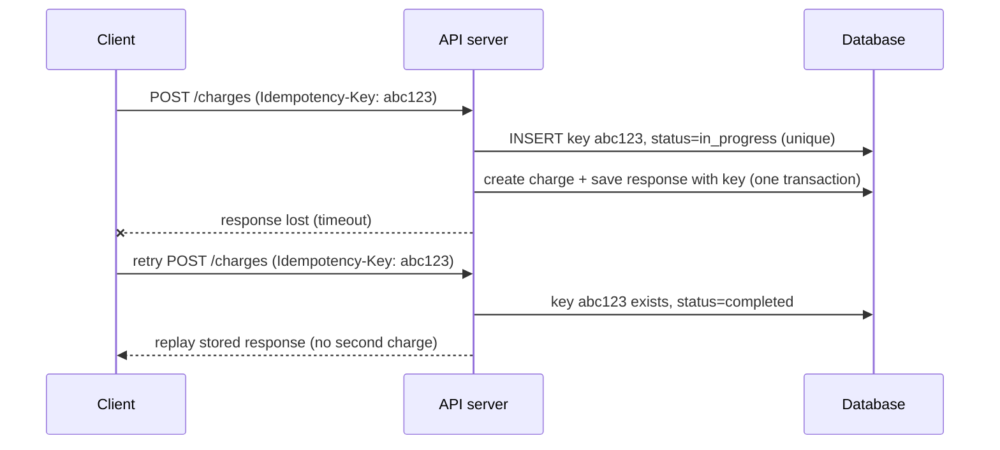

# 11. Idempotency, or how to make retries safe

_Sent 2026-10-10_

When a network call fails, you often can't tell what happened. A client sends "charge $50" and the connection times out. Did the charge go through? If you don't retry, you might lose the payment. If you do, you might charge twice. The at-least-once queues from Lesson 9 cause the same problem from the other side, because consumers will see some messages twice. Idempotency is the fix. An operation is idempotent if running it several times has the same effect as running it once, so retrying is always safe.

Some operations are already idempotent: "set email to x", `PUT`, and `DELETE`. Others aren't, like "create order", "add to balance", and "send email". For those you add an **idempotency key**. The client creates a unique ID (usually a UUID) for each *logical operation* and sends that same ID on every retry of it.

**What the server does**
1. Insert the key, scoped to the account, into a column with a unique constraint. Do it as one atomic insert, not a check followed by an insert, or two retries arriving at the same moment will both get through.
2. If the insert succeeded, do the work and save the final response next to the key, ideally in the same transaction as the side effect.
3. If the key already exists and is finished, return the saved response. If it's still in progress, return a 409 conflict or wait.
4. If the key matches but the request body is different, reject it. That's a client bug, not a retry.

**In the real world:** Stripe's API accepts an `Idempotency-Key` header on `POST` requests. It saves the status code and body of the first request that actually started running, replays them for any retry with the same key, rejects a reused key sent with different parameters, and keeps keys for at least 24 hours. AWS uses the same idea for launching EC2 servers: `RunInstances` takes a `ClientToken`, so a retried launch doesn't start a second batch of servers.

**Tradeoffs and gotchas**
- **Save the key and do the side effect in one commit.** If you crash after charging the card but before marking the key done, the retry charges again. That's the dual-write problem from Lesson 9 coming back.
- **Calls to outside services can't join your transaction.** When you call a payment network or email provider, pass your key along if they accept one. If they don't, record your progress step by step so a retry picks up where it stopped instead of starting over.
- **Create the key once per operation, not once per attempt.** A client that makes a new UUID on every retry gets no protection. Create it when the user clicks Pay.
- **Keys expire.** A retry that arrives after its key is gone runs as a brand-new request, so keep keys long enough to cover your slowest realistic retry or replay.
- **Choose which results to save.** Save final outcomes, but not validation errors or conflicts, so the client can fix the request and try again.
- **Use a natural key when you have one.** An order ID or invoice number often beats a random UUID. On the consumer side, conditional writes give you the same protection: an upsert, a version check, or "insert only if this message ID is new."

**Try this:** You run a consumer that reads "send push notification" events from Kafka with at-least-once delivery, and the push provider's API doesn't support idempotency. How would you keep duplicate notifications to a minimum, and what's the one gap you can't fully close?
