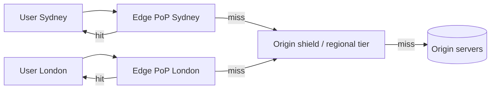

# 12. CDNs, or moving your bytes closer to the user

_Sent 2026-10-11_

Light in fiber travels about 200 km per millisecond. A user in Sydney talking to a server in Virginia pays over 200 ms for every round trip, and a fresh HTTPS connection needs several round trips (TCP setup plus TLS) before the first byte even arrives. A faster server can't fix physics. A CDN (content delivery network) fixes it by running hundreds of edge servers, called PoPs (points of presence), close to users. The edge handles the connection locally and serves cached responses, so most requests never cross an ocean. As a bonus, your origin servers only see a small slice of the traffic.

**The parts that matter for design**
- **Getting users to an edge.** With anycast, every PoP advertises the same IP address and internet routing sends each user to a nearby one, which is how Cloudflare works. With DNS-based routing, the CDN's DNS answers with the IP of a nearby PoP, which Akamai has historically done. Anycast makes failover simpler. DNS gives finer control but depends on where the user's DNS resolver happens to be.
- **Pull vs. push.** A pull CDN fetches from your origin the first time something is requested and caches it. That's the default for web assets and APIs. A push CDN gets content uploaded ahead of time, which suits large, predictable files like videos or game patches.
- **The cache key.** By default it's the URL, but you can add headers, cookies, query parameters, or device type. Include too much and your hit rate collapses. Include too little and you serve one user's page to someone else.
- **Freshness.** `Cache-Control: s-maxage` sets how long shared caches like the CDN keep a copy, separately from `max-age` for browsers. `stale-while-revalidate` lets the edge serve a slightly old copy while it fetches a fresh one in the background. `stale-if-error` lets it keep serving when your origin is down, so the CDN protects your uptime as well as your speed.
- **Invalidation.** The best approach is versioned URLs like `app.3f9a2c.js`: cache them forever and never purge. For content whose URL can't change, you purge. Tag-based purging (Fastly calls these surrogate keys, others call them cache tags) clears every page that shows product 123 in one call, without tracking individual URLs.
- **Tiered caching (an origin shield).** Edges that miss go to a regional middle tier instead of your origin. A thousand PoPs missing at once turn into a handful of origin requests.

**In the real world:** Netflix built its own CDN, Open Connect, instead of renting one. It places storage-heavy servers directly inside internet providers' networks and at internet exchange points, free to providers that qualify. Since Netflix can predict what people will watch, it loads popular titles onto those servers overnight in each region, when traffic is low. At peak hours most streams come from a box a few network hops from the viewer, while AWS mostly handles browsing, sign-in, and choosing which server to stream from. It's push-CDN thinking taken to the extreme: if you know demand in advance, put the bytes there ahead of time.

**Tradeoffs and gotchas**
- **Purge stampedes.** Purge a popular object everywhere and every edge misses at once, flooding your origin. Request coalescing (one fetch per object per PoP), an origin shield, and `stale-while-revalidate` protect you.
- **Leaking personalized content.** If you cache a response that depends on a cookie or `Authorization` header but leave that out of the cache key, you've built a data leak. Mark personalized responses `private` or `no-store`, or split the page into a cacheable shell plus a separate personalized API call.
- **The long tail.** Huge catalogs where each item is rarely requested get poor hit rates at the edge. Tiered caching helps, but some workloads just don't benefit much.
- **Staleness vs. origin load.** Long TTLs mean fewer origin requests but slower corrections. Short TTLs mean fresher content but more origin traffic. Tag purges let you keep long TTLs and still fix mistakes fast.
- **Everyone shares the same dependency.** On June 8, 2021, one customer's valid config change triggered a hidden bug at Fastly, and most of its network returned errors for close to an hour. Reddit, Amazon, and major news sites went down with it. Big sites protect themselves by using more than one CDN with DNS failover, at the cost of keeping configs and purges in sync across vendors.

**Try this:** You run a news site. Article corrections must show up worldwide within 10 seconds, the homepage changes every minute during breaking news, and signed-in users see a personalized header with their name and saved stories. Your origin handles 500 requests per second, but traffic spikes to 200,000. What do you cache at the CDN, and what goes in the cache key? What TTLs and `Cache-Control` headers do you set for articles versus the homepage? And how do you push a correction out in under 10 seconds without overwhelming the origin?
