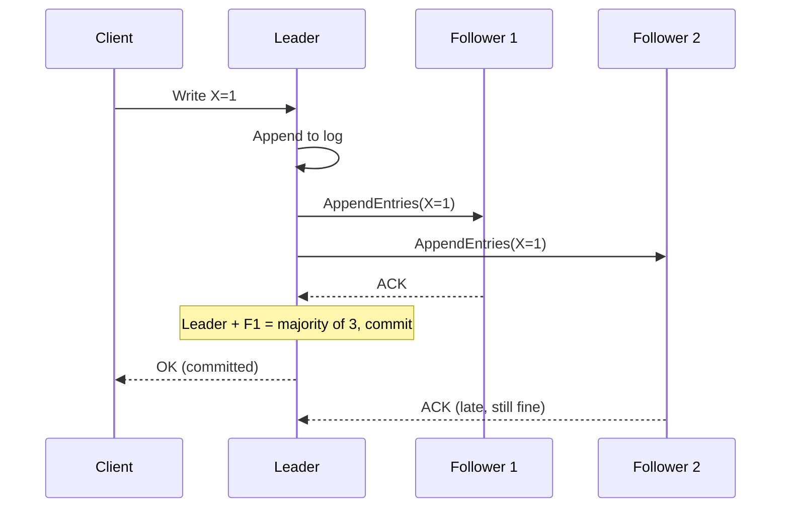

# 13. Consensus

_Sent 2026-10-12_

When several machines have to agree on one fact, like who the leader is, what the next committed write is, or which config is active, you need **consensus**. Without it, a failover can end up with two primaries, or replicas drift apart and never reconcile. That's the split brain from Lesson 6.

The hard part is that networks partition, clocks drift, and a node can pause, then wake up still believing old things. Consensus protocols survive all of that with one rule: **a majority has to agree before anything is committed**. Any two majorities overlap in at least one node, so two conflicting decisions can never both win.

**How Raft works**

Most systems you'll run into use Raft or something close to it. It has three pieces:
1. **Leader election.** Followers expect regular heartbeats from the leader. If none arrive before a randomized timeout, a follower becomes a candidate and asks for votes, and the first one to win a majority becomes leader. Each election starts a new numbered term, so a deposed leader's stale messages get rejected.
2. **Log replication.** Clients write only to the leader. The leader appends each write to its log, sends it to followers, and commits it once a majority has it.
3. **Safety first.** During a bad partition with no reachable majority, the cluster stops accepting writes. It never commits two different values for the same log slot.

A famous result called FLP proves that in a fully asynchronous network, no protocol can guarantee both safety and progress if even one node can crash. Raft and Paxos choose safety. They stall rather than corrupt data, and they pick back up as soon as a majority can talk again.

**In the real world:** Kubernetes stores all its cluster state in etcd, which runs Raft. A `kubectl apply` that changes a Deployment only becomes real once a majority of etcd nodes commit it. That's why losing the etcd majority freezes the whole control plane even while every worker node is healthy: running pods keep running, but nothing can be scheduled or changed. ZooKeeper (inspired by Google's Chubby lock service) and Consul use the same pattern for locks, configuration, and leader election.

**Tradeoffs and gotchas**
- **The majority cost.** Five nodes survive two failures, and three nodes survive one. Four nodes still only survive one, so clusters almost always have an odd number of nodes.
- **The leader is a bottleneck.** Every write goes through one node. That's fine for control-plane data like config and locks, but painful for hot user data. Systems like CockroachDB and TiKV get around this by sharding data into thousands of small, independent Raft groups.
- **Election storms.** Timeouts that are too aggressive, combined with a flaky network, cause constant re-elections and stalled writes. Randomized timeouts and sensible heartbeat intervals prevent this.
- **Don't fix split brain by allowing two primaries.** Once you accept writes on both sides of a partition, you've given up consensus, and healing means resolving conflicts or losing data.
- **Use consensus sparingly.** Use it for the small set of facts that must never fork, and keep everything else on cheaper replication.

**Try this:** You're designing a distributed lock service, so that only one job runner holds the lease for queue Q at a time. How many nodes do you run? What happens when the leader dies in the middle of a lease? How does a client know its lock is still valid without trusting one machine's clock? (Hint: think about the fencing tokens from Lesson 6.) And what breaks if the lease's TTL is shorter than your worst-case failover time?
