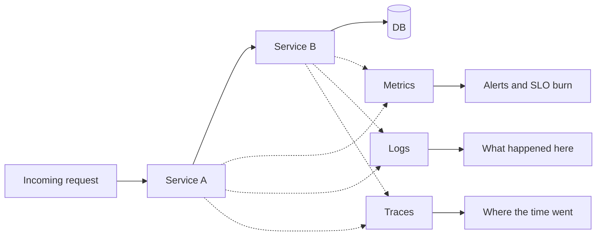

# 14. Observability

_Sent 2026-10-13_

You've scaled the system, cached the hot path, and replicated the database. Then at 2 AM the p99 spikes and someone asks what's broken. Without observability, you're guessing from a pile of unrelated graphs.

**Observability** means being able to ask new questions about how production is behaving, from the outside, without shipping new code just to debug. Monitoring tells you that something you defined in advance has gone wrong. Observability lets you dig into *why*.

**The three signals**
- **Metrics** are numbers over time: request rate, error rate, latency histograms. They're cheap to aggregate and great for alerting, but bad at answering "which user?"
- **Logs** are structured records of individual events. They're very detailed and expensive at high volume, and they answer "what exactly failed on this request?"
- **Traces** follow one request across services as a chain of timed steps called spans. They're how you find out the checkout API is fine but the call to payments took 800 ms.

Tie them together by putting a **trace ID** on every log line and span. Without that shared ID you have three separate piles of data instead of one story.

**SLIs and SLOs give the data a purpose**

CPU at 70% isn't a user problem. An **SLI** (service level indicator) measures something users feel, like "checkouts that succeed within 2 seconds." An **SLO** (service level objective) is your target for it, like "99.9% of checkouts over 30 days." The remaining 0.1% is your **error budget**, the amount of failure you can afford before you pause feature work and fix reliability.

Google's SRE book made this approach popular. If you're burning the budget fast, page someone. If you're burning it slowly, file a ticket. Metrics tell you how fast the budget is burning, and logs and traces tell you why.

**In the real world:** most teams now instrument their services with **OpenTelemetry**, an open standard formed by merging the OpenTracing and OpenCensus projects. It emits all three signals in one format, so you can send them to whatever backends you like: Prometheus and Grafana for metrics, Loki or CloudWatch for logs, and Jaeger, Tempo, or Honeycomb for traces.

**Tradeoffs and gotchas**
- **High-cardinality labels.** Add `user_id` as a metric label and you create millions of separate time series, which can take down your metrics database. Keep fine-grained details like that in logs and traces.
- **Sampling away the problem.** Keep only 1% of traces and you'll miss the rare slow path that only hits one customer. When you can, use tail-based sampling, which decides after a request finishes and keeps every error and slow request.
- **Log landfills.** Unstructured log lines for every request cost a lot and still can't answer "show me failed payments for merchant X." Log structured fields and drop the noise.
- **Dashboards nobody reads.** Forty panels nobody looks at don't help. Start from your SLOs and work backward to the few signals that explain when you're burning budget.

**Try this:** Your checkout service calls Inventory, Pricing, and Payments. After a deploy, checkout's p99 jumped from 200 ms to 2 seconds, but each dependency's *average* latency looks fine. Which signal do you reach for first, and what are you looking for? And how would an SLO on "checkout succeeds in under 500 ms" change when you page someone versus just file a ticket?
