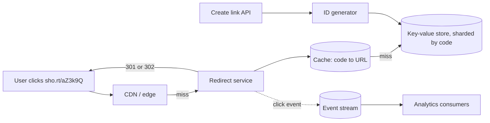

# 15. Case study, designing a URL shortener

_Sent 2026-10-14_

The fundamentals are covered, so now we start putting them together. A URL shortener (think bit.ly) is the classic first case study. It's small enough to design in one sitting and touches IDs, caching, sharding, and CDNs all at once.

**Requirements first.** You need to turn a long URL into a short code, redirect the code back to the original URL fast, and optionally support custom aliases, expiry, and click analytics. Reads dwarf writes, often 100 to 1 or more. Say 100 million new links a month and around 4,000 redirects per second at peak. Redirects have to be fast and must never point to the wrong place.

**The core decision is how you generate codes**
- **Hash the long URL** (for example, take the first 7 characters of a base62 encoding of its hash). The same URL always gets the same code, but you have to handle collisions, and two users shortening the same URL share a link and its analytics.
- **Counter plus base62.** Take a unique number and encode it with the characters a to z, A to Z, and 0 to 9. Seven characters give \( 62^7 \approx 3.5 \) trillion codes (six give about 56 billion). The counter can't be a single database row, so hand each app server a block of IDs (say 10,000 at a time) from a small coordinating service, or use a Snowflake-style ID like Instagram's from (lesson 7).
- **Random codes with an insert-if-absent check.** These are simple and hard to guess, which matters if links shouldn't be enumerable. Retry on the rare collision.

**Storage and reads.** The data is just a code mapped to a URL plus some metadata, with no joins, so a key-value store sharded by code fits perfectly (lesson 5 and lesson 7). Popular links follow a power law, so a cache in front (lesson 1) absorbs most reads, and a CDN can serve redirects for the hottest links straight from the edge (lesson 12).

**301 or 302?** A 301 (permanent) redirect lets browsers and CDNs cache it, which is fastest and cheapest, but you stop seeing repeat clicks and can't change the target later. A 302 (temporary) sends every click through your servers, which costs more but keeps analytics accurate and lets you edit or disable links. Most commercial shorteners use 302 for that reason.

**In the real world:** bit.ly has described handling billions of clicks a month, with redirects kept as lean as possible and click data sent off to separate pipelines instead of being written to the database inline. That's the pattern above: keep the hot path to one cache lookup, and stream everything else.

**A second example: link rot and goo.gl (2025).** Google ran the goo.gl shortener, then announced it would shut the service down, then in 2025 walked it back: links that were *still actively used* keep redirecting, while links that had shown no recent activity (and already displayed a "this link will no longer work" warning) stopped. This is the quiet, central risk of running a shortener that interview answers skip: a short link is a permanent promise. Every link ever printed on a poster or embedded in an email depends on your service outliving it, so you have to plan for storage that grows forever, for abuse cleanup, and for the political and operational cost of ever turning a code off. "Just store code to URL" is easy; honoring that mapping for a decade is the real system.

**Tradeoffs and gotchas**
- **Don't let analytics slow down redirects.** Publish a click event to a stream (lesson 9) and return immediately. Counting can lag a few seconds and nobody notices.
- **Abuse is the real operational problem.** Shorteners get used to hide phishing and malware links. Check URLs against threat lists when links are created, rate-limit creation (lesson 10), and be able to disable a code instantly, which is another reason to prefer 302.
- **Sequential codes are guessable.** Anyone can walk through every link if the codes count upward. Shuffle the ID with a reversible permutation, or use random codes, if links might be private.
- **Custom aliases share the namespace.** Reserve them with the same atomic insert-if-absent, so two users can't claim `sho.rt/launch` at the same moment.
- **Expiry and storage growth.** Links accumulate forever unless you expire them, but expiring an in-use link breaks someone. Decide the policy up front, since changing it later is painful.
- **Caching 301s is a trap for editable links.** Once a browser caches a permanent redirect, you can't take it back, so use 301 only for codes you will never repoint.

**When to use which code scheme.** Use counter-plus-base62 when you want short, dense, non-colliding codes and can run a small ID-allocation service. Use random codes when links must be unguessable or private, accepting occasional collision retries. Use hashing only when you *want* identical URLs to collapse to one code and share analytics. For the redirect itself, prefer 302 when you need analytics or editability (most products), and 301 only for truly permanent, high-traffic links you'll never change.

**Try this:** Your shortener goes viral and one link gets 200,000 clicks per second for an hour, all through 302 redirects so the marketing team gets exact counts. Where does that traffic land at each layer, what melts first, and how would you keep exact counts without sending every click to your origin?
