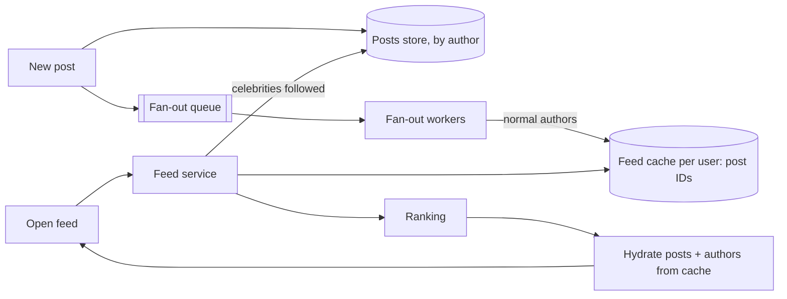

# 16. Case study, designing a news feed

_Sent 2026-10-15_

Yesterday's URL shortener was a single lookup. A news feed (think the X home timeline or Instagram's feed) is the opposite: every page load pulls together posts from hundreds of accounts, ranked and fresh. It's the classic case study because one decision, when you do the merging, shapes the whole design.

**Requirements.** Users post, follow people, and open a home feed of recent posts from people they follow. Example numbers, not any real company's: 200 million daily users, each opening the feed about 10 times a day. That's around 25,000 feed reads per second on average, against maybe 2,000 new posts per second. Feeds should load in under 200 ms, and a new post should show up for followers within a few seconds. Reads dominate, so the design optimizes for reads.

**The core decision: fan-out on write or fan-out on read**
- **Fan-out on write (push).** When someone posts, you immediately add the post ID to a precomputed feed list for each follower, usually stored in Redis. Reading a feed is then one cheap lookup. The cost lands on writes: a user with 1,000 followers causes 1,000 inserts per post.
- **Fan-out on read (pull).** You store posts only by author. When someone opens their feed, you fetch recent posts from everyone they follow and merge them. Writes are cheap, but every read fans out across hundreds of accounts, often on many shards, which is Lesson 7's scatter-gather problem and Lesson 3's tail latency.
- **The hybrid everyone actually uses.** Push for normal accounts and pull for celebrities. When someone with 50 million followers posts, you don't write 50 million inserts. Instead, each reader's feed merges their precomputed list with a quick pull of the few celebrity accounts they follow.

**Store IDs, not posts.** The feed cache holds only post IDs, often capped at the latest few hundred per user. When serving, you "hydrate" them by fetching the post bodies and author info from their own caches. That keeps feed lists small, and an edited or deleted post only has to change in one place.

**In the real world:** Twitter described exactly this setup in talks around 2012 and 2013. Each tweet was fanned out into in-memory Redis timelines for followers. Accounts with huge followings were handled differently, by merging their tweets in at read time, because pushing one celebrity tweet into tens of millions of timelines took too long and delayed everyone else's.

**Tradeoffs and gotchas**
- **Wasted work for inactive users.** Pushing into the feeds of people who haven't opened the app in months burns writes and memory. Skip inactive users and rebuild their feed with a pull when they come back.
- **Fan-out lag.** Fan-out happens through a queue (Lesson 9), so a busy moment can delay delivery. Watch consumer lag, and handle the poster's own feed specially so they see their post immediately (read-your-writes from Lesson 8).
- **Deletes and blocks.** A deleted post or a newly blocked account may still sit in thousands of precomputed lists. Filter at hydration time, not just at fan-out time.
- **Ranking changes the shape.** A ranked feed scores hundreds of candidate posts per request with a model, so candidate generation and ranking each need their own latency budget.
- **Retries cause duplicates.** Fan-out workers get at-least-once delivery, so inserts into feed lists should be idempotent (Lesson 11). A sorted set keyed by post ID makes that free.

**Try this:** A user follows 2,000 accounts, 15 of them celebrities with over 10 million followers each, and opens the app after a week away. Walk through how your hybrid design builds their feed. What's in their precomputed list, what has to be pulled live, and how do you keep it under 200 ms?
