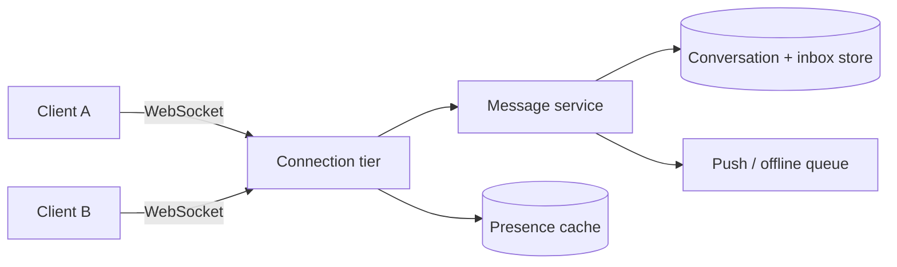

# 17. Case study: a chat app

_Sent 2026-10-16_

A chat system seems simple until you write down what it has to do. Messages need to arrive fast and in the right order within each conversation. You're holding millions of open connections at once. Someone who's offline still has to get the message later. And in a group, one send turns into many deliveries.

**What you're really building**

There are three layers that matter. Clients keep long-lived WebSockets (or something similar) open to a connection tier. That tier is stateful, because it knows which user is connected to which server. Behind it, a message service saves the history so it can't be lost and fans each message out to the people who should get it. Presence, meaning "online now," is a separate and cheaper signal, so keep it apart from the part that makes messages durable.

**What it looks like in practice**

WhatsApp-style designs run a large fleet of connection servers and store messages in a partitioned database, keyed by conversation or by each recipient's inbox. In a 1:1 chat, fan-out is easy. You write the message once, then push it to the other person's open connection if they have one. If they don't, you queue it so they get it when their app syncs, or as a push notification.

Big groups are harder. If you copy every message into every member's inbox, the work grows with group size times message count. The common fix is to write the message once to the conversation's log and let each member read forward from their own saved position in it. That's the same tradeoff you saw in the news feed lesson: fan out when a post is written, or when someone reads.

Delivery receipts (sent, delivered, read) are just more events on that same log. They don't need their own separate database.

**Tradeoffs and gotchas**

- **Ordering vs availability.** You don't need one strict order across every chat, and it's expensive to get. Number messages within each conversation instead. If the network splits, it's better to accept the message and sort things out later than to leave the sender stuck.
- **Connection state.** Sticky load balancing helps, but when servers die you're safer with a registry that maps each user to their connection server. If you miss a disconnect, you'll keep pushing messages into nothing until the heartbeat times out.
- **Fan-out cost.** Copying every message into each inbox of a 10,000-person group will overload your write servers and storage. Use the read-from-the-log approach for large rooms and copy into inboxes only for small chats.
- **Idempotency.** Clients retry sends. If you don't remove duplicates using a message ID the client generates, the same message shows up twice.
- **Presence lies.** Expect it to lag behind reality. "Last seen" is fine to show, but don't promise someone is definitely online.

**Try this**

Design unread counts for a user with three devices. When they read a message on their phone, how do their laptop and tablet update without double-counting, racing each other, or leaving a chat marked unread forever after a flaky sync?
