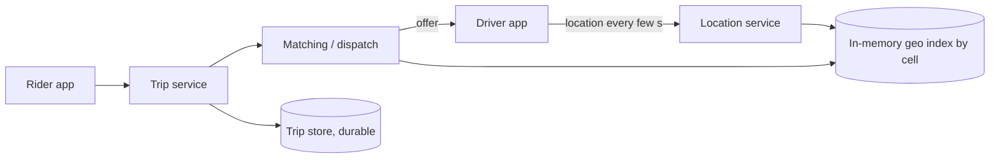

# 18. Case study: ride-sharing

_Sent 2026-10-17_

A ride-sharing app looks like a map with cars on it, but the hard part is a fast-moving matching problem. Hundreds of thousands of drivers report their location every few seconds. A rider asks for a car and expects an offer in seconds. And the same driver must never be handed to two riders at once.

**What you're really building**

Split it into two very different workloads. Location tracking is a firehose of tiny, short-lived writes: you only care where a driver is right now, so it lives in memory, not in your main database. Trips are the opposite: low volume, but every state change (requested, accepted, picked up, completed, paid) must be durable and correct.

A quick sizing pass with example numbers shows why. With 1M drivers online and one update every 4 seconds, that's about 250,000 location writes per second. Trip requests might be a few thousand per second. Those two shouldn't share a storage engine.

**Finding nearby drivers**

You can't scan every driver for each request, so you bucket the map into cells. Each cell holds the set of drivers currently in it, and a "who's nearby?" query looks at the rider's cell plus its neighbors. Geohash strings, Google's S2 cells, and Uber's open-source H3 hexagonal grid are the common choices. Uber built H3 partly because hexagons have neighbors that are all the same distance away, which makes "the ring of cells around me" cleaner than with squares.

Cells also give you a natural shard key: partition the geo index by region or cell so one city's rush hour doesn't touch another's servers. Straight-line distance is only a first filter. Real matching ranks the candidates by estimated time to pickup on the road network, since the closest car may be across a river.

**Matching without double-booking**

Dispatch picks a driver and sends an offer. The dangerous moment is two riders' requests choosing the same driver at the same time. The usual fix is to make the driver's state change atomic: move them from available to offered with a compare-and-set or a short lease that expires if they don't respond in, say, 15 seconds. Whoever wins the swap gets the driver; the loser moves on to the next candidate. Accept and cancel requests need idempotency keys, because phones on bad networks retry.

**Tradeoffs and gotchas**

- **Freshness vs cost.** More frequent location pings give better matches and smoother maps, but cost battery, bandwidth, and write load. Many apps send less often when a driver is idle and more often during a trip.
- **Hot cells.** A stadium letting out or an airport queue puts thousands of drivers and riders in a few cells. Split busy cells finer or spread them across more servers.
- **Losing location data is fine; losing trips is not.** If a location node dies, drivers repopulate it within seconds on their next ping. Trip state needs replication and a real database.
- **Greedy vs batched matching.** Giving each rider the nearest free driver right away is simple, but collecting requests for a second or two and matching them as a batch can cut total pickup time across the city. You trade a little latency for better overall results.
- **Surge pricing is a feedback loop.** It reads supply and demand per area and changes both, so compute it on a separate, slower path and smooth it so prices don't swing wildly every few seconds.

**Try this**

Design shared rides (pooling). A car already carrying one rider gets a second request. How do you decide whether adding the pickup is worth the detour for the first rider, and how do you keep that decision fast when the car's route and position keep changing?
