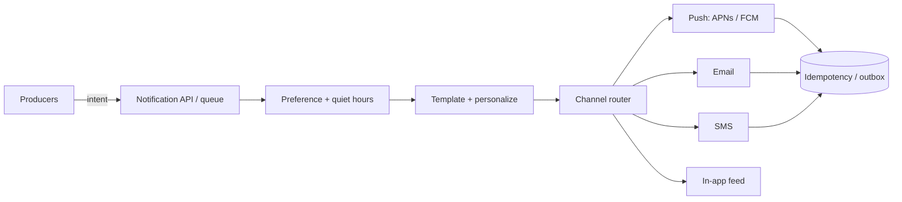

# 19. Case study: notification system

_Sent 2026-10-18_

A notification system looks like "send this user a message," but at scale it's a fan-out engine with preferences, multiple channels, and a hard requirement that the same alert doesn't fire twice while urgent ones still arrive in seconds.

**What you're really building**

Producers (orders, likes, security alerts, digests) shouldn't talk to APNs, FCM, Twilio, or SES directly. They emit a notification intent — who, what happened, how urgent — and a notification service owns the rest: preference checks, template rendering, channel choice, rate limits, retries, and delivery receipts.

**The hard paths**

Preferences matter more than people admit. Per-user, per-event-type toggles, quiet hours, and "email me a daily digest instead of every like" turn one event into zero, one, or many deliveries. Evaluate that early so you don't render and then throw the work away.

Channel choice is usually priority-driven: security alerts go push + email (and sometimes SMS); social noise stays in-app or batched. Push tokens and phone numbers change, so treat device registry as its own store with soft deletes when a provider returns "invalid token."

Volume splits by shape. A like on a celebrity post can fan out to millions of followers — that's the news-feed fan-out problem again, often solved with async workers and per-shard queues. A password-reset email is the opposite: tiny volume, but latency and deliverability are everything. Don't put both on the same worker pool without priority lanes.

**Real-world anchors**

Slack's notification pipeline gates on mute, channel settings, and presence so a busy workspace doesn't wake you for every message. Banks treat fraud SMS as a separate, higher-SLA path from marketing email. Instagram and similar apps batch "X liked your photo" into digests so the same preference system that allows instant DMs can collapse low-priority events.

**Tradeoffs and gotchas**

- **At-least-once delivery vs duplicates.** Providers and your workers retry. Use an idempotency key per (user, event, channel) so a replay doesn't send three SMS for one login. An outbox or dedupe store is almost mandatory.
- **Fan-out amplification.** One viral event can enqueue millions of jobs. Cap, shard by user id, and shed load on low-priority types before you melt the push providers' rate limits.
- **Quiet hours vs urgency.** A blanket mute must still allow account-takeover alerts. Encode urgency in the intent, not in the channel.
- **Provider outages.** APNs or an SMS gateway will flake. Queue with backoff, circuit-break a bad provider, and fall back (push → email) only when the product allows it — silent fallback can surprise users.
- **Templates and i18n.** Keep copy out of producer code. Version templates so a bad deploy doesn't corrupt every channel at once.
- **In-app vs push.** In-app notifications are durable state the client pulls or syncs; push is a hint to open the app. Losing a push is annoying; losing the in-app record is a product bug.

**Try this**

Design "notify all followers when a creator goes live." With 10M followers, how do you avoid a thundering herd on your queues and on the push providers, and how do you still get the notification out within, say, 30 seconds for users who opted into instant alerts?
