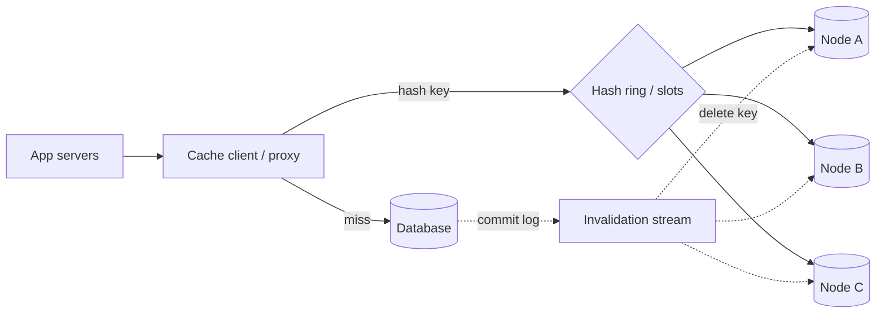

# 20. Case study: distributed cache

_Sent 2026-10-19_

Lesson 1 covered *why* you cache. This one is about building the cache tier itself: a fleet of memory nodes that hundreds of app servers share, which has to survive node loss, hot keys, and stampedes without becoming the thing that takes your database down.

**What you're really building**

A key-value store in RAM, split across many nodes, with three jobs: route each key to the right node, keep hit rate high as nodes come and go, and never let a miss storm reach the database all at once. Durability is explicitly not a goal. The source of truth lives elsewhere.

**The hard parts**

Routing. `hash(key) % N` remaps almost every key when N changes, which empties the cache in one go. Consistent hashing (with virtual nodes so load evens out) moves only about 1/N of keys when a node joins or leaves. Redis Cluster takes a related approach: it splits the keyspace into 16,384 fixed hash slots and moves slots between nodes, so a rebalance is an explicit, bounded migration.

Where routing lives. A smart client library is fastest (no extra hop) but every language needs one and every config change has to reach every app server. A proxy layer (Twemproxy, mcrouter, Envoy) adds a hop but centralizes routing, pooling, and failover.

Invalidation. Writes go to the database, then the cache entry is *deleted*, not overwritten. A delete is idempotent and safe to retry. A set can race with another set and leave stale data behind. Tailing the database commit log to drive deletes means you don't depend on every code path remembering to invalidate.

**Real-world anchor**

Facebook's "Scaling Memcache at Facebook" paper (NSDI 2013) is the standard reference. They put mcrouter in front of memcached pools, drove invalidations from the MySQL commit log (a daemon called mcsqueal), and used *leases*: on a miss, the cache hands one client a token to refill the key, while the others briefly wait or accept slightly stale data. That one mechanism fixed both stale sets and thundering herds. They also kept a small "gutter" pool that takes traffic for failed nodes, so a dead box doesn't turn into a burst of database load.

**Tradeoffs and gotchas**

- **Hot keys.** One celebrity profile or config blob can saturate a single node no matter how good your hashing is. Replicate hot keys across several nodes, add a tiny in-process L1 cache with a short TTL, or split the key (`key#1..key#k`) and pick one at random on reads.
- **Stampedes.** A popular key expiring sends every request to the DB at once. Use leases or request coalescing (single-flight), and add jitter to TTLs so keys don't all expire together.
- **Replication vs capacity.** Replicating each key doubles memory but keeps hit rate up when a node dies. Many teams skip replication, accept the brief miss spike, and rely on gutter or warm-up instead.
- **Cold start.** A new cluster or region at a 0% hit rate can flatten the database. Warm it from an existing cluster, or ramp traffic over gradually.
- **Eviction policy.** LRU is the default, but scan-heavy workloads push out hot data. LFU or segmented LRU (Redis offers LFU modes) holds up better. Watch evictions per second as a capacity signal, not just memory used.
- **Big values.** A 5 MB value hogs the network and stalls the node's event loop (Redis runs commands on a single thread). Cap value sizes or compress, and paginate large collections.

**Try this**

You run a 20-node cache in front of a product catalog. A flash sale makes one item's key take 40% of all reads, and two nodes fail during the spike. Walk through what happens to hit rate and DB load under plain consistent hashing, then design the changes (hot-key handling, leases, failover) that keep the database under 2x its normal QPS.
