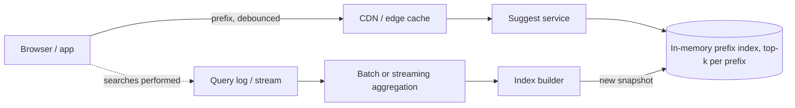

# 21. Case study: search typeahead

_Sent 2026-10-20_

Typeahead is the box that suggests "system design interview" after you type "sys". It looks tiny, but it has to answer on every keystroke, usually in well under 100 ms end to end, for millions of users at once. That makes it a very read-heavy, latency-first system.

**What you're really building**

Two separate paths. The serving path takes a prefix and returns the top 5 to 10 completions, fast. The data path collects what people actually search for, counts it, and rebuilds the suggestion data every so often. Keep them apart: the serving path never computes popularity on the fly, it only looks up answers that were prepared ahead of time.

**The core data structure**

A trie (prefix tree) maps each prefix to the queries under it. The trick that makes it fast is storing the top-k completions directly on each node, so answering "sys" is one lookup instead of walking the whole subtree and sorting. That costs memory and makes updates heavier, which is fine because you rebuild in the background and swap in a fresh snapshot. Many teams skip a literal trie and use a key-value map from prefix to its top-k list, which shards and caches easily.

**Ranking and freshness**

Popularity usually means search counts with time decay, so last week's news fades and today's spike can rise. A daily batch job handles the long tail, and a small streaming layer can boost trending queries within minutes. Personal history (your own recent searches) is mixed in on the client or in a separate small lookup, since it can't live in a shared cache.

**Real-world example**

Google's autocomplete combines query popularity, freshness, location, and language, and removes predictions that break its policies. Many smaller sites build the same thing on Elasticsearch's completion suggester, which keeps a prefix structure in memory for fast lookups.

**Tradeoffs and gotchas**

- **Request volume.** One query can be 5 to 10 requests. Debounce on the client (wait about 100 to 200 ms after typing stops), cancel stale requests, and cache short prefixes hard, since "a" and "s" are asked constantly.
- **Sharding by prefix.** Splitting by first letter is uneven, because far more queries start with "s" than "x". Shard by a hash of the prefix, or split hot ranges further.
- **Freshness vs cost.** Rebuilding the whole index every minute is wasteful, and rebuilding weekly misses breaking news. Batch plus a small trending layer is the usual middle ground.
- **Filtering.** Suggestions put words in users' mouths. You need blocklists and review for offensive, defamatory, or unsafe completions, applied before a suggestion can show.
- **Typos and languages.** Prefix matching alone fails on "sytem". Fuzzy matching and per-language tokenization help, but they cost latency, so many systems try exact prefix first and fall back.

**Try this**

Design trending suggestions so that a breaking news term starts appearing in typeahead within 5 minutes of people searching for it, without rebuilding the whole index. Where do you count, how do you avoid one bot inflating a term, and how do the serving nodes pick up the change?
