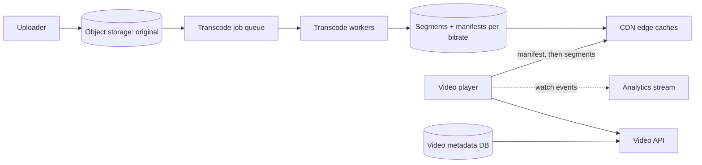

# 22. Case study: video streaming

_Sent 2026-10-21_

A video platform looks like "upload a file, play a file." In practice it's two very different systems: a slow, heavy processing pipeline that turns one upload into dozens of files, and a delivery network that pushes most of your internet traffic to viewers on every kind of connection without the video stalling.

**What you're really building**

On upload, the original goes to object storage and a job queue kicks off transcoding. Each video gets encoded into several resolutions and bitrates (say 240p up to 4K), cut into small segments of a few seconds each, with a manifest file that lists them all. Playback is then just the player fetching the manifest and downloading segments over plain HTTP, mostly from a CDN.

**Adaptive bitrate is the core idea**

Formats like HLS and MPEG-DASH let the player switch quality between segments. If your bandwidth drops, the next segment comes from the lower-bitrate version, so you see a blurrier picture instead of a spinner. The player watches its own buffer and download speed and picks each next segment. That puts the clever logic on the client, and keeps the servers simple: they only serve static files, which is exactly what CDNs are good at.

**Real-world example**

Netflix encodes each title ahead of time and places copies inside internet providers' networks with its Open Connect appliances, so most bytes never cross the wider internet. It also moved from one fixed set of bitrates to per-title encoding, choosing settings per show, because a cartoon needs far fewer bits than a grainy action film to look good. YouTube faces the other extreme: a huge volume of uploads, most rarely watched, so it can't afford to encode everything into every format up front.

**Tradeoffs and gotchas**

- **Encode everything vs on demand.** Pre-encoding every bitrate gives the fastest playback but wastes compute and storage on videos nobody watches. Many platforms encode a few common versions right away and add the rest only once a video gets popular.
- **Segment length.** Short segments let quality adapt faster and lower live latency, but mean more requests and larger manifests. Around 2 to 6 seconds is common.
- **Popular vs long-tail content.** A hit show stays in edge caches. The millions of rarely watched videos miss the cache and hit origin, so you need a tiered cache or origin shield in between.
- **Transcoding is parallel work.** Split a long video into chunks, encode them on many workers at once, and stitch the results. Make each chunk job idempotent, since workers die and jobs retry.
- **Live is a different problem.** For live streams you can't encode ahead of time, and every second of delay matters. Low-latency HLS and smaller segments help, at the cost of more load and less buffer against hiccups.
- **Start-up time matters most.** Viewers leave if the first frame is slow. Start at a modest bitrate, prefetch the first segments, and keep the manifest and first segment hot in the cache.

**Try this**

A video goes viral and jumps from 100 views to 5 million in an hour, but it was uploaded with only a 480p version. Design what happens: how you detect it, how you add higher quality versions without disrupting people already watching, and how you protect your origin while the CDN caches warm up.
