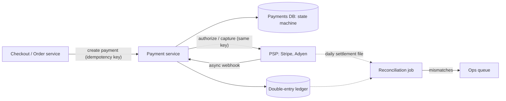

# 23. Case Study: Designing a Payment System

_Sent 2026-10-22_

Most systems can retry, cache, or drop a message and nobody notices. Payments can't. Charge twice and you've stolen from a customer; charge zero times and you've given away product. So the core problem isn't throughput (even big merchants do far fewer payment writes than a feed does reads). It's **exactly-once money movement across systems you don't control**: your service, a payment service provider (PSP) like Stripe or Adyen, the card network, and the issuing bank, any of which can time out without telling you whether the money moved.

## The shape of it

Four ideas carry the design:

1. **Idempotency end to end.** The client generates a key per checkout attempt and every hop reuses it. Your payment service stores the key with the request and the result, so a retry returns the saved result instead of charging again. You pass the same key to the PSP, which dedupes on its side too.
2. **An explicit state machine.** A payment moves `CREATED → AUTHORIZED → CAPTURED → SETTLED`, with side exits to `FAILED`, `VOIDED`, `REFUNDED`. You write the intent (`CREATED`, with the key) *before* calling the PSP, so a crash mid-call leaves a record that says "outcome unknown, go find out," not silence.
3. **A double-entry ledger.** Every movement is an immutable pair of entries that sums to zero (debit customer receivable, credit merchant payable). You never update a balance in place; you append and derive. Mistakes are fixed with new reversing entries, which gives you a full audit trail.
4. **Reconciliation.** Webhooks get lost and PSPs occasionally disagree with you. A daily job compares your ledger against the PSP's settlement report and flags every mismatch for a human or an automated fix.

## Real-world example

Stripe's API lets you send an `Idempotency-Key` header on POST requests; if you retry with the same key, Stripe returns the original response (including errors) rather than performing the operation again, and keys can be pruned once they're at least 24 hours old. Stripe also delivers results like `payment_intent.succeeded` via webhooks that may arrive more than once or out of order, so their docs tell you to dedupe on the event ID and not assume ordering. Card payments typically split into **authorize** (the issuer places a hold) and **capture** (you actually take the money), which is why a hotel or a marketplace can hold funds at booking and capture later, and why an uncaptured authorization eventually expires.

## Tradeoffs and failure modes

- **The timeout problem.** If the PSP call times out, you don't know whether it charged. Never "just retry with a new key." Retry with the same key, or query the PSP by your reference, and leave the payment in a pending state until you know.
- **Sync vs async.** Waiting on the PSP synchronously gives a fast checkout answer but ties your latency to theirs. Treating the webhook as the source of truth is more robust but means the UI must handle "processing" honestly.
- **Strong consistency where it matters.** The ledger and payment state belong in a transactional store (Postgres is a common choice) with the state change and ledger entries in one transaction. Eventual consistency is fine for analytics and receipts, not for balances.
- **Outbox over dual writes.** Updating your DB and publishing an event as two separate steps will eventually lose one. Write the event to an outbox table in the same transaction and relay it.
- **Multi-PSP routing.** A second provider improves resilience and authorization rates, but now reconciliation, refunds, and idempotency span two systems with different semantics.
- **Money types.** Store integer minor units (cents) plus a currency code, never floats. Some currencies have zero or three decimal places.

## Try this

A customer clicks "Pay," your service calls the PSP, the call times out after 10 seconds, and the customer, seeing a spinner, clicks "Pay" again from a second tab. Walk through exactly what your system does on each request so the customer is charged once, the second tab shows the right result, and the ledger stays balanced if the PSP's webhook shows up an hour late.
