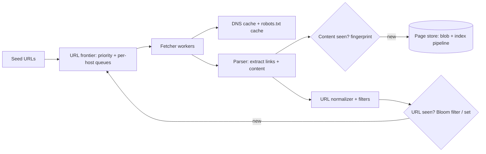

# 24. Case study: web crawler

_Sent 2026-10-23_

A crawler sounds like a loop: fetch a page, pull out links, fetch those. The hard part is everything that loop ignores. The web is effectively infinite (calendars, faceted search, session IDs in URLs), full of duplicates, and owned by other people who will block you if you hammer them. So the real problem is **deciding what to fetch next, while staying polite to every host and never wasting a fetch on something you've already seen**.

## The shape of it

The center of the design is the **URL frontier**, and the classic layout comes from the Mercator crawler:

- **Front queues handle priority.** A scorer puts each URL into one of several queues by importance (link-based rank, how often the page changes, how fresh it needs to be). Higher-priority queues get picked more often.
- **Back queues handle politeness.** Each back queue holds URLs for exactly one host, and a min-heap tracks the earliest time each host may be hit again. A worker only pulls from a host whose timer has expired, so you get, say, one request per host every few seconds no matter how many workers you run.

Around that, the pieces are:

- **Fetchers** are I/O-bound, so lots of async connections per machine. They respect `robots.txt` (standardized as RFC 9309 in 2022), cached per host, and use a local DNS cache because DNS lookups quickly become a bottleneck at crawl scale.
- **URL normalization** (lowercase the host, drop fragments, sort or strip tracking query params) happens before the seen-check, otherwise `?utm_source=x` and `?utm_source=y` look like two pages.
- **Two dedupe checks.** "Have I queued this URL?" is a big set, often fronted by a Bloom filter (a false positive just means you skip a page, which is acceptable). "Have I seen this content?" uses a fingerprint, because mirrors and syndicated copies live at different URLs.
- **Partitioning by host.** Shard the frontier by a hash of the hostname so one machine owns all of a host's URLs. Politeness then becomes a local decision instead of a distributed lock.

## Real-world example

Google's 2007 paper "Detecting Near-Duplicates for Web Crawling" (Manku, Jain, Das Sarma) describes using Charikar's **SimHash** to give each page a 64-bit fingerprint where similar pages get fingerprints that differ in only a few bits. They used it across a repository of about 8 billion pages, flagging pages within 3 bits of each other as near-duplicates. Exact hashes like SHA-256 can't do that: change one timestamp in the footer and the hash is completely different.

On the open side, **Common Crawl** runs a public crawl and publishes regular snapshots of billions of pages, in WARC files on S3, which is why so many search and ML projects start there instead of writing their own crawler.

## Tradeoffs and failure modes

- **Spider traps.** Infinite calendars, `?page=` loops and URLs that keep growing will eat your budget. Defend with a max URL length, a max path depth, a per-host page budget, and pattern detection for repeating path segments.
- **Politeness vs throughput.** Per-host rate limits mean a crawl of a few giant sites is slow no matter how many machines you add. Throughput comes from crawling *many* hosts in parallel, not one host faster.
- **Freshness vs coverage.** Every fetch spent re-crawling a news homepage is a fetch not spent discovering new pages. Most crawlers estimate each page's change rate and schedule revisits by it, and use conditional requests (`If-Modified-Since`, `ETag`) so an unchanged page costs a `304` instead of a full body.
- **Hot hosts in one shard.** Hashing by host keeps politeness simple but a huge site lands on one partition. Big hosts sometimes get split across several back queues with a shared rate budget.
- **JavaScript rendering.** Many pages are empty until JS runs. Rendering in a headless browser costs far more than a plain HTTP fetch, so it's usually a second, smaller tier for pages that need it.
- **Crash recovery.** The frontier is huge and mostly on disk. Checkpoint it, and make "fetch URL" idempotent so a replayed batch just overwrites the same page record.

## Try this

You're asked to build a crawler that keeps the product pages of 50,000 online stores fresh within 6 hours, so a price-comparison site can show current prices. Some stores have 10 pages, a few have 5 million. How do you size the fetcher fleet, split the per-host politeness budget for the giant stores, and decide which pages to re-crawl first when you can't hit everything every 6 hours?
