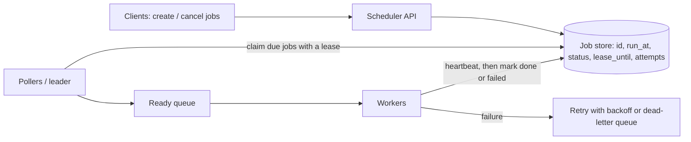

# 25. Case study: distributed job scheduler

_Sent 2026-10-24_

Every company ends up with a pile of "run this later" work: send the invoice at the end of the billing cycle, retry the failed webhook in 5 minutes, rebuild the search index every night at 2 AM. On one box, cron does it. Across a fleet, cron falls apart: if the box dies, jobs silently stop, and if you run cron on two boxes, every job runs twice. A distributed scheduler solves one problem: **making sure each due job fires once, on time-ish, even while machines crash, and making it safe when "once" fails**.

## The shape of it

Split it into three jobs that scale differently:

- **Storage of intent.** A durable table of jobs keyed by `run_at`. Recurring jobs are stored as a rule (a cron expression), and the scheduler materializes the next run after each fire, rather than pre-creating a million future rows.
- **Triggering.** Something has to notice that `run_at <= now()`. Either a single elected leader scans for due jobs, or many pollers share the work by partitioning the job space (by hash of job id, or by time bucket).
- **Execution.** Workers pull ready jobs from a queue. They're stateless and scale horizontally, separate from the trigger path, so a slow job never delays the clock.

The key move is the **lease**. A poller doesn't just read a due job; it atomically claims it: set `status = running, lease_until = now() + 60s, owner = me`. The worker heartbeats to extend the lease. If the worker dies, the lease expires and another poller can reclaim the job. In Postgres this is the well-known pattern `SELECT ... WHERE run_at <= now() AND status = 'pending' ORDER BY run_at LIMIT 100 FOR UPDATE SKIP LOCKED`, which lets many pollers grab different rows without blocking each other.

## Real-world example

Kubernetes CronJob is a good one to read, because its docs are honest about the guarantees. The controller creates a Job object roughly once per scheduled time, but the documentation says it can occasionally create two Jobs or none, and tells you to make your jobs idempotent. It also gives you the knobs every scheduler needs: `concurrencyPolicy` (`Allow`, `Forbid`, or `Replace` when the previous run is still going), and `startingDeadlineSeconds` (if a run was missed by more than this, for example because the controller was down, skip it instead of firing late).

For long multi-step jobs, workflow engines like Temporal go further: timers and each step's progress are persisted as an event history, so a workflow can sleep for 30 days and resume on a different machine as if nothing happened.

## Tradeoffs and failure modes

- **Exactly-once is not on the menu.** A worker can finish the work and then crash before marking it done; the lease expires and the job runs again. You get at-least-once delivery, so the job itself needs an idempotency key (lesson 11) to make the second run harmless.
- **Lease length is a dial.** Short leases recover from crashes fast but risk a slow, healthy job being stolen mid-run (two workers doing it at once). Long leases are safe but leave dead jobs stuck. Heartbeats plus a fencing token (the attempt number, checked on write) cover both.
- **The thundering midnight.** Everyone schedules things at `0 0 * * *`. A million jobs due in the same second will flatten the workers and whatever they call. Add jitter to recurring jobs, and rate-limit execution per tenant or per downstream.
- **Missed-run policy.** After an outage, do you fire all 6 missed hourly runs, just the latest one, or none? There's no universal answer; make it a per-job setting.
- **Clock and time zones.** "9 AM daily" in New York is a different UTC time after daylight saving changes, and some local times happen twice or not at all. Store the rule with its time zone and compute the next run in that zone.
- **Hot polling.** Scanning one big table every second gets expensive. Index on `(status, run_at)`, partition by time bucket, or use a timing wheel in memory for the next few minutes and only hit the database to refill it.

## Try this

You're building scheduled reminders for a calendar app with 50 million users. Users can create, edit, and cancel reminders up to a year ahead, and a reminder should fire within 5 seconds of its time. How do you store future reminders, how do pollers split the work without double-firing, and what happens to a reminder the user cancels one second before it was due to fire?
