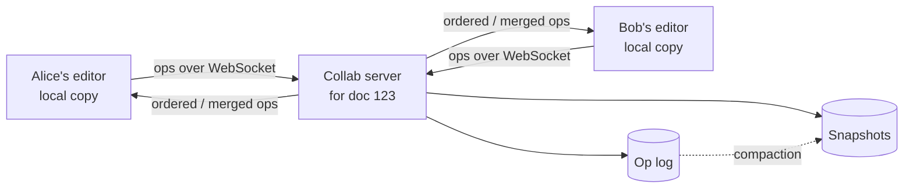

# 26. Case study: collaborative editor

_Sent 2026-10-25_

Think Google Docs: several people type in the same document at once, everyone sees each other's edits within a fraction of a second, and when the dust settles every copy is identical. The hard part isn't the network. It's that two people edit the same spot concurrently, and you need every replica to converge on the same result without anyone's keystrokes vanishing.

## The core problem

Alice and Bob both start with `cat`. Alice inserts `s` at position 3 (`cats`). At the same moment Bob inserts `h` at position 1 (`chat`). Each applies the other's op by index: Alice gets `chats`, but Bob applies "insert `s` at 3" to `chat` and gets `chast`. The replicas have diverged, because indexes go stale the moment someone else edits before them.

There are two families of fixes:

- **Operational transformation (OT).** Keep index-based operations, but before applying a remote op, transform it against the concurrent ops you've already applied. Alice's "insert at 3" arriving after Bob's insert at 1 becomes "insert at 4", so Bob also gets `chats`. In practice OT relies on a central server to put all ops in one order, which keeps the transform rules manageable.
- **CRDTs (conflict-free replicated data types).** Give every character a unique, stable ID (for example, client ID plus a counter) and express inserts as "after character X" instead of "at index 3". Deletes mark IDs as tombstones. Because ops reference IDs, not positions, they commute: apply them in any order and every replica converges, with no central server required.

The shape is the same either way. Each client applies its own edits locally first (so typing never waits on the network), sends ops over a WebSocket to a server that owns that document, and receives everyone else's ops. The server appends ops to a log and periodically writes a snapshot so loading a document doesn't mean replaying every keystroke since 2019. Route all sessions for one document to the same server (consistent hashing on doc ID, lesson 2), since it holds the live state in memory. Presence, like cursors and selections, goes over the same socket but is ephemeral and never hits the log.

## Real-world example

Google Docs uses OT with a central server, an approach descended from the Jupiter collaboration system: the server assigns each op a revision number, and clients transform their pending local ops against anything the server accepted first.

Figma took a different path and wrote about it in its 2019 post "How Figma's multiplayer technology works". A design file is a tree of objects with properties, not a long string, so Figma uses a CRDT-inspired scheme with the server as the authority: concurrent changes to the same property of the same object resolve as last-writer-wins at the server, while changes to different properties never conflict. Open-source libraries like Yjs and Automerge give you full CRDTs for text and JSON-like documents if you want peer-to-peer or offline-first editing.

## A second example: Peritext (Ink & Switch, 2022)

Plain-text CRDTs converge on *which characters exist*, but rich text adds a second problem: what about **formatting**? Peritext is a CRDT designed for collaborative rich text. It stores formatting as `addMark`/`removeMark` spans anchored to stable character IDs rather than to positions, so concurrent edits commute and replicas converge, just like characters do. The clever part is preserving *intent*: if one user bolds the sentence "The brown fox jumped." while another simultaneously inserts a word inside it, Peritext extends the bold span to cover the newly inserted text, because the intent was "bold this whole sentence." It's a good illustration that "converge to an identical copy" is necessary but not sufficient; a well-designed merge also has to respect what each user meant, which is a semantic decision, not just a data-structure one.

## Tradeoffs and failure modes

- **OT vs CRDT.** OT keeps the document compact and is battle-tested at Google scale, but transform functions are notoriously easy to get subtly wrong, and it leans on a central server. CRDTs converge without coordination and handle offline editing naturally, but carry per-character metadata and tombstones, so memory and document size grow unless you compact.
- **Convergence isn't intent.** Both approaches guarantee identical copies, not sensible ones. Two people bolding and deleting the same sentence will converge on *something*; whether it's what either wanted is a product decision, which is exactly the gap Peritext tries to close for formatting.
- **Offline edits.** A user who edits on a plane for three hours comes back with a large batch of ops. CRDTs merge it; OT has to transform it against everything that happened meanwhile, which can be slow and surprising.
- **Rich text and nested structure.** Text is the easy case. Tables, comments anchored to ranges, and nested objects each need their own conflict rules, and anchors have to survive concurrent edits around them.
- **Hot documents.** One doc is one server. A company all-hands doc with 500 live editors pins that box; you cap editors, batch ops, or degrade viewers to read-only with throttled updates (lesson 37).
- **Undo.** "Undo my last change" in a shared document means undoing *my* op, not the most recent op overall, and inverting it against everything that happened since. This is harder than it looks in both models.
- **Server failover.** If the doc server dies, clients reconnect to a new owner, which loads the latest snapshot plus the log tail. Clients must resend unacknowledged ops, and the server must dedupe them (lesson 11 again).

## When to use which

Pick OT with a central server when you want a compact document, you already have a server in the path anyway, and you can invest in getting the transform functions right (the Google Docs model). Pick a CRDT when you need offline-first or peer-to-peer editing, or when you'd rather avoid a central ordering authority, accepting the metadata and compaction overhead (Yjs/Automerge). For rich text specifically, use a format-aware CRDT like Peritext or a server-authoritative scheme so formatting intent survives concurrent edits. For plain presence (cursors), skip all of this: it's ephemeral and doesn't need to converge.

## Try this

You're adding collaborative editing to a spreadsheet app. Two users concurrently edit cell B7; another user inserts a new row above row 5 while someone is typing a formula `=SUM(B2:B9)`. Which conflicts can be last-writer-wins per cell, which ones need transformation (hint: what happens to that formula's range), and would you pick OT or a CRDT?
