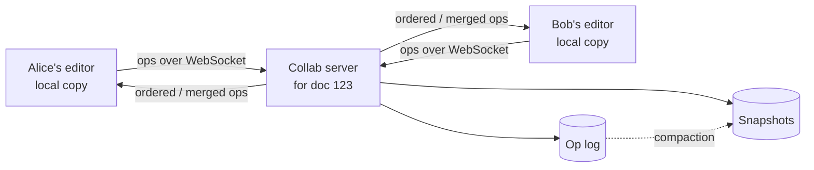

# 26. Case study: collaborative editor

_Sent 2026-10-25_

Think Google Docs: several people type in the same document at once, everyone sees each other's edits within a fraction of a second, and when the dust settles every copy is identical. The hard part isn't the network. It's that two people edit the same spot concurrently, and you need every replica to converge on the same result without anyone's keystrokes vanishing.

## The core problem

Alice and Bob both start with `cat`. Alice inserts `s` at position 3 (`cats`). At the same moment Bob inserts `h` at position 1 (`chat`). Each applies the other's op by index: Alice gets `chats`, but Bob applies "insert `s` at 3" to `chat` and gets `chast`. The replicas have diverged, because indexes go stale the moment someone else edits before them.

There are two families of fixes:

- **Operational transformation (OT).** Keep index-based operations, but before applying a remote op, transform it against the concurrent ops you've already applied. Alice's "insert at 3" arriving after Bob's insert at 1 becomes "insert at 4", so Bob also gets `chats`. In practice OT relies on a central server to put all ops in one order, which keeps the transform rules manageable.
- **CRDTs (conflict-free replicated data types).** Give every character a unique, stable ID (for example, client ID plus a counter) and express inserts as "after character X" instead of "at index 3". Deletes mark IDs as tombstones. Because ops reference IDs, not positions, they commute: apply them in any order and every replica converges, with no central server required.

The shape is the same either way. Each client applies its own edits locally first (so typing never waits on the network), sends ops over a WebSocket to a server that owns that document, and receives everyone else's ops. The server appends ops to a log and periodically writes a snapshot so loading a document doesn't mean replaying every keystroke since 2019. Route all sessions for one document to the same server (consistent hashing on doc ID), since it holds the live state in memory. Presence, like cursors and selections, goes over the same socket but is ephemeral and never hits the log.

## Real-world example

Google Docs uses OT with a central server, an approach descended from the Jupiter collaboration system: the server assigns each op a revision number, and clients transform their pending local ops against anything the server accepted first.

Figma took a different path and wrote about it in its 2019 post "How Figma's multiplayer technology works". A design file is a tree of objects with properties, not a long string, so Figma uses a CRDT-inspired scheme with the server as the authority: concurrent changes to the same property of the same object resolve as last-writer-wins at the server, while changes to different properties never conflict. Open-source libraries like Yjs and Automerge give you full CRDTs for text and JSON-like documents if you want peer-to-peer or offline-first editing.

## Tradeoffs and failure modes

- **OT vs CRDT.** OT keeps the document compact and is battle-tested at Google scale, but transform functions are notoriously easy to get subtly wrong, and it leans on a central server. CRDTs converge without coordination and handle offline editing naturally, but carry per-character metadata and tombstones, so memory and document size grow unless you compact.
- **Convergence isn't intent.** Both approaches guarantee identical copies, not sensible ones. Two people bolding and deleting the same sentence will converge on *something*; whether it's what either wanted is a product decision.
- **Offline edits.** A user who edits on a plane for three hours comes back with a large batch of ops. CRDTs merge it; OT has to transform it against everything that happened meanwhile, which can be slow and surprising.
- **Hot documents.** One doc is one server. A company all-hands doc with 500 live editors pins that box; you cap editors, batch ops, or degrade viewers to read-only with throttled updates.
- **Undo.** "Undo my last change" in a shared document means undoing *my* op, not the most recent op overall, and inverting it against everything that happened since. This is harder than it looks in both models.
- **Server failover.** If the doc server dies, clients reconnect to a new owner, which loads the latest snapshot plus the log tail. Clients must resend unacknowledged ops, and the server must dedupe them (lesson 11 again).

## Try this

You're adding collaborative editing to a spreadsheet app. Two users concurrently edit cell B7; another user inserts a new row above row 5 while someone is typing a formula `=SUM(B2:B9)`. Which conflicts can be last-writer-wins per cell, which ones need transformation (hint: what happens to that formula's range), and would you pick OT or a CRDT?
