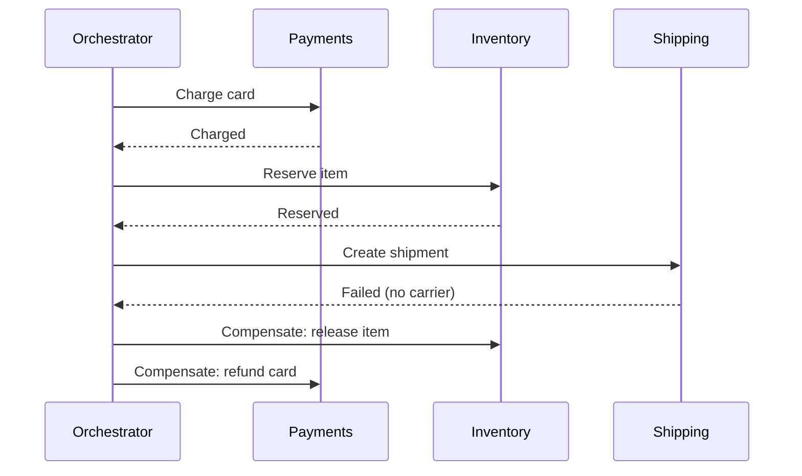

# 27. Distributed transactions: two-phase commit vs sagas

_Sent 2026-10-26_

Inside one database, "debit the wallet and create the order" is a single transaction: both happen or neither does. Split those into a wallet service and an order service with their own databases, and that guarantee disappears. A crash between the two writes leaves you with money taken and no order. There are two main ways to get atomicity back across services, and they make opposite tradeoffs.

**Two-phase commit (2PC)** keeps real atomicity. A coordinator asks every participant to *prepare*. Each one does the work, durably logs it, holds its locks, and votes yes or no. If every vote is yes, the coordinator logs "commit" and tells everyone to commit; any no means abort everywhere. The catch is the gap after a participant votes yes. It has promised to commit if told to, so it can't decide on its own. If the coordinator dies right then, participants sit "in doubt," holding locks, until it comes back. That's why 2PC is called a blocking protocol.

**Sagas** give up atomicity for availability. You break the work into a chain of local transactions, each committed on its own, and give every step a *compensating* action that semantically undoes it (refund the charge, release the seat). If step 3 fails, you run the compensations for steps 2 and 1 in reverse. Nothing is ever locked across services, but the system is visibly in between states while the saga runs.

## Real-world example

Google Spanner does use 2PC across shards, but each participant is itself a Paxos-replicated group, coordinator included. A single machine dying doesn't strand the protocol, because the group elects a new leader that still has the logged state. That's how it gets cross-shard ACID without the classic blocking problem, at the cost of extra consensus round trips on every distributed commit.

Most microservice shops go the saga route. Uber built Cadence, which became Temporal, largely to run long workflows like this: the orchestrator is durable code, so if it crashes mid-saga it resumes from its event history and still runs the remaining steps or compensations. AWS documents the same pattern with Step Functions, using a travel booking (flight, hotel, car) where a failed car rental triggers cancel-hotel and cancel-flight. The term itself comes from Garcia-Molina and Salem's 1987 paper "Sagas," written about long-lived transactions in a single database.

## Tradeoffs and failure modes

- **Latency and availability.** 2PC needs every participant up and adds round trips while locks are held. One slow service slows everyone. Sagas let each step commit and move on.
- **No isolation in sagas.** Other requests can see the charge before the order exists, or read stock that's about to be released. Common fixes are semantic locks (mark the row `PENDING` so others treat it carefully), commutative updates, and rereading values before acting on them.
- **Compensations aren't rollbacks.** You can't un-send an email or un-ship a box. Order steps so the irreversible ones come last, after the *pivot* step, which is the point after which the saga only moves forward and retries.
- **Every step must be idempotent.** Orchestrators retry, and so do compensations. A refund that runs twice is its own incident.
- **Orchestration vs choreography.** A central orchestrator makes the flow readable and easy to monitor. Choreography (each service reacts to the previous one's event) avoids a central component but turns the flow into something nobody can see in one place. Past three or four steps, most teams pick orchestration.
- **Don't forget the dual-write problem.** Each saga step that commits locally and then emits an event needs the outbox pattern, or the saga can silently stall.

## Try this

You're designing checkout for a concert ticketing site: hold a seat, charge the card, issue a QR ticket, and email it. Seats are scarce and a held seat blocks other buyers. Which steps go before and after the pivot? What does the compensation for each step look like, and how do you keep a seat from being held forever if the orchestrator crashes and the buyer walks away?
