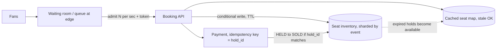

# 28. Case study: ticket booking (Ticketmaster-style)
_Sent 2026-10-27_

**The problem.** A stadium has 60,000 seats and 2 million fans arrive in the same minute. Every seat has to be sold exactly once, nobody should pay for a seat someone else got, and the site can't fall over. This one is hard because of contention, not storage: thousands of people want the same few rows at the same moment.

**Core design: separate the hold from the sale.**

1. **Waiting room.** Before anyone touches inventory, put them in a virtual queue at the edge (CDN or a lightweight queue service). Admit users at a rate the booking backend can handle, and hand each one a signed, short-lived token. This turns an unbounded spike into a steady flow you control.
2. **Seat hold with a TTL.** When a user picks a seat, grab it with one atomic conditional write:
   `UPDATE seats SET state='HELD', hold_id=:h, expires_at=now()+interval '10 min' WHERE event_id=:e AND seat_id=:s AND (state='AVAILABLE' OR (state='HELD' AND expires_at < now()))`
   One row updated means you got it; zero means someone beat you. Redis `SET seat:{e}:{s} {hold} NX PX 600000` does the same job when it sits in front of the database. Either way the TTL means an abandoned cart frees the seat with no cleanup job.
3. **Checkout.** Charge using an idempotency key tied to the hold_id (lesson 23). Then flip `HELD` to `SOLD` with another conditional write that requires `hold_id = :h`. If payment succeeds but the hold expired, refund automatically; that's rare but it will happen.
4. **Reads stay cheap.** The seat map users browse is a cached, slightly stale view. Only the hold step has to be strongly consistent, and it's scoped to a single seat row, so you get row-level contention instead of a global lock.

**Real-world example.** On Nov 15, 2022, the Taylor Swift Eras Tour presale on Ticketmaster broke down. Ticketmaster said the system saw about 3.5 billion requests, four times its previous peak, and it ended up pausing and then cancelling the general public sale. The lesson people took away: the waiting room and bot filtering are core parts of the system, not extras. Ticketmaster's Verified Fan presale codes exist to shrink and screen the crowd before it ever reaches inventory.

**Tradeoffs and failure modes.**
- **Hold length.** Long holds feel kind to buyers, but bots use them to hoard seats and inventory looks sold out when it isn't. Short holds push real buyers out halfway through checkout. Cap holds per token and per account.
- **Hot events.** Shard inventory by event, which means one huge on-sale lands on one shard. Spread it by section within the event, and rely on the queue's admit rate as your real throttle.
- **General admission vs reserved seating.** GA is just a counter, so use an atomic decrement or pre-split the count into buckets so writers don't all fight over one row. Reserved seating needs a lock per seat.
- **"Best available" picking.** If the server picks seats for you, contention moves into the allocator. Hand out candidate blocks per worker instead of letting every request scan the whole map.
- **Fairness vs throughput.** A strict first-in-first-out queue is fair but rewards whoever hammers the refresh button. Randomizing everyone who joins before the start time is fairer, which is why many queues shuffle early arrivals.
- **Stale map.** Users click seats that are already gone. That's fine as long as the hold step is the source of truth and the UI handles losing the race gracefully.

**Try this.** A festival sells 100,000 general admission tickets in three price tiers, with a limit of 4 per person, and the cheapest tier always sells out in seconds. Design the inventory counter so it doesn't become one hot row, enforce the per-person limit across retries and multiple devices, and decide what happens to a held ticket when the buyer's card declines on the third try.
