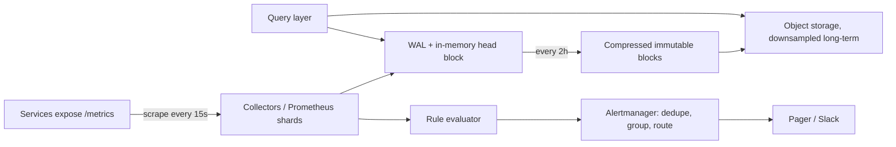

# 29. Case study: a metrics and monitoring system
_Sent 2026-10-28_

**The problem.** Thousands of services each emit hundreds of numbers (request counts, latencies, queue depths) every 10 to 15 seconds. You need to ingest millions of samples per second, answer dashboard queries over the last hour in milliseconds, keep a year of history cheaply, and fire alerts within a minute when something breaks. And the monitoring system must stay up when everything else is falling over, because that's exactly when people look at it.

**The data model.** A time series is a metric name plus a set of labels, like `http_requests_total{service="checkout", status="500", region="us-east"}`. Each series is an append-only stream of (timestamp, float) pairs. The writes are tiny, constant, and almost always "now", while reads scan ranges of recent data. That shape is why general-purpose databases do poorly here and purpose-built time series databases (TSDBs) win.

**The design.**

1. **Collection, push or pull.** Prometheus pulls: it scrapes each target's HTTP endpoint on a schedule. Pull gives you free health checks (a failed scrape is itself a signal) and keeps the collector in control of load. Push (StatsD, OpenTelemetry exporters) suits short-lived jobs and clients behind NAT. Big systems usually support both.
2. **Ingest path.** Incoming samples land in a write-ahead log for durability and an in-memory "head" holding the latest couple of hours. Prometheus cuts the head into immutable 2-hour blocks on disk, then compacts them into larger ones.
3. **Compression.** Facebook's Gorilla paper (VLDB 2015) is the classic trick: store timestamps as delta-of-deltas (regular scrapes make most of them zero, so one bit) and values as the XOR with the previous value (slowly changing numbers XOR to mostly zeros). They reported about 1.37 bytes per sample instead of 16. Prometheus uses a close variant.
4. **Indexing.** An inverted index maps each label pair to the list of series IDs that have it, so `status="500" AND service="checkout"` is a posting-list intersection, the same idea as a search engine.
5. **Long-term storage.** Local disk holds days to weeks. Thanos, Cortex, and Grafana Mimir ship blocks to object storage like S3 and downsample old data (for example, 5-minute and 1-hour rollups), so a year-long graph reads thousands of points instead of millions.
6. **Alerting.** A rule evaluator runs queries on a timer ("error rate above 2% for 5 minutes"). Alertmanager then deduplicates across replicas, groups related alerts into one page, and applies silences and routing.

**Real-world example.** Prometheus came out of SoundCloud in 2012, modeled on Google's internal Borgmon, and became the second CNCF project to graduate after Kubernetes. Its standard scaling story is to shard scrapes across many Prometheus servers by team or region, run each one as an identical HA pair, and put Thanos or Mimir on top for a global query view and cheap retention.

**Tradeoffs and failure modes.**
- **Cardinality is the killer.** Every unique label combination is a new series. Put `user_id` or a request ID in a label and one metric becomes millions of series, blowing up memory and the index. Real systems enforce per-tenant series limits and reject the offending writes.
- **Accuracy versus cost.** Averages hide tail latency, and you can't average percentiles across hosts. Histograms with fixed buckets (or newer native/exponential histograms) let you merge distributions correctly at some storage cost.
- **Downsampling loses spikes.** A 1-hour rollup of the average smooths away a 30-second outage, so keep min and max alongside it.
- **Who watches the watcher.** Monitoring that shares infrastructure with what it watches dies along with it. Run it on separate infrastructure and add a "dead man's switch" alert that always fires, so its silence pages someone.
- **HA pairs give duplicates.** Two replicas scrape the same targets with slightly different timestamps, so the query layer or Alertmanager has to deduplicate.

**Try this.** A product team wants per-customer latency dashboards for 200,000 customers across 50 endpoints. Putting `customer_id` on the latency histogram would create how many series, and what would you build instead? Think about top-N tracking, sampling into a columnar store like ClickHouse, or pushing it to logs and traces.
