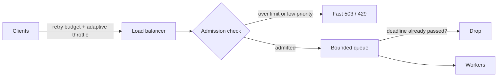

# 30. Backpressure and load shedding
_Sent 2026-10-29_

**The problem.** Every service has a maximum useful throughput. Push past it and things don't just slow down, they get worse: queues grow, latency climbs past client timeouts, clients retry, and now the server is spending its capacity on requests nobody is waiting for anymore. Throughput of *successful* work can drop toward zero even though the CPU is pegged. That's congestion collapse, and the fix is to say "no" early and cheaply instead of "yes" late and expensively.

Two tools do that:

- **Backpressure** pushes the "slow down" signal upstream. A bounded queue that blocks the producer, a TCP receive window, Reactive Streams' `request(n)`, or Kafka consumers that simply pull at their own pace. The producer slows to match the consumer.
- **Load shedding** drops work when backpressure isn't possible, usually because the callers are external users you can't block. The server rejects some requests fast (HTTP 503 or 429) so the rest finish within their deadline.

**How it's done well.**
1. **Bound every queue.** An unbounded queue just converts overload into latency, then into timeouts. A small bound turns it into fast rejections you can reason about.
2. **Reject cheaply and early.** A rejection should cost a tiny fraction of a real request, otherwise rejecting is itself the overload.
3. **Respect deadlines.** Propagate the client's deadline (gRPC does this) and drop queued work whose deadline has already passed. Serving it is pure waste.
4. **Shed by priority.** Drop prefetches, analytics, and batch jobs before checkout and login.
5. **Use LIFO under pressure.** Some systems switch the queue to last-in-first-out when it's backed up, because the newest requests are the ones whose clients are most likely still waiting.
6. **Limit concurrency adaptively.** Instead of a fixed rate limit, cap in-flight requests and adjust the cap from observed latency (Netflix's open-source `concurrency-limits` library does this with TCP-style algorithms like Vegas and AIMD).

**Real-world example.** Google's SRE book (chapter 21, "Handling Overload") describes *client-side adaptive throttling*. Each client tracks, over the last two minutes, how many requests it sent and how many the backend accepted. It then rejects new requests locally, without sending them, with probability `max(0, (requests − K × accepts) / (requests + 1))`, with K typically 2. When the backend starts refusing, clients back off on their own, so rejections stop costing network and server work. Amazon's Builders' Library article "Using load shedding to avoid overload" makes the companion point from the server side: measure goodput (successful responses within the client's timeout), not throughput, and shed so goodput stays flat as offered load keeps rising.

**Tradeoffs and failure modes.**
- **Retry storms.** Retries multiply load exactly when the system is weakest; three layers each retrying 3 times is up to 27 times the load at the bottom. Retry only at one layer, use jittered exponential backoff, and cap retries with a budget (for example, retries can't exceed 10% of requests; gRPC's retry throttling uses a token bucket for this).
- **Metastable failure.** The trigger (a brief spike, a cache flush) goes away but the system stays down, because the retries and cold caches it caused keep load above capacity. Bronson et al. named this in "Metastable Failures in Distributed Systems" (HotOS 2021). Recovery often needs shedding hard, not just adding servers.
- **Shedding the wrong thing.** Random drops hit a user's 5th call in a 6-call page load and waste the first four. Shedding whole sessions or by priority keeps goodput higher.
- **Health checks vs shedding.** If an overloaded node fails its health check, the load balancer pulls it and its load lands on peers, which then fail too. Health checks should answer "am I broken?", not "am I busy?"
- **Thresholds are guesses.** Static limits go stale as code and hardware change; adaptive limits can oscillate. Load-test to find the real knee of the curve.

**Try this.** Your checkout API sits behind an API gateway and calls inventory, pricing, and payments. On Black Friday, traffic is 4 times normal and pricing's p99 jumps from 40 ms to 2 s. Design the overload behavior end to end: where queues are bounded, which requests get shed first, how deadlines flow from the browser down to pricing, where retries are allowed and how they're budgeted, and how you'd tell from dashboards that you're shedding correctly rather than just failing.
