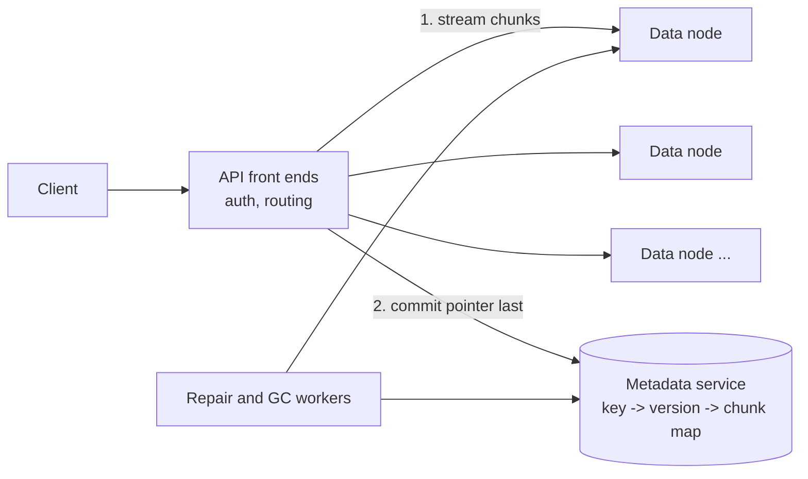

# 31. Object storage (an S3-like blob store)
_Sent 2026-10-30_

**The problem.** You need to store billions of immutable blobs (photos, backups, video segments, ML datasets), from a few KB to many GB, cheaply and durably, behind a dead-simple API: `PUT bucket/key`, `GET bucket/key`, `LIST prefix`, `DELETE`. No in-place edits, no POSIX. That simplicity is what lets it scale.

**The core idea: split metadata from data.** Bytes go to a big fleet of dumb storage nodes. A separate, strongly consistent metadata service maps `(bucket, key, version)` to where those bytes live. Almost every hard decision lives in one of those two layers.

**Write path.** The front end splits the object into chunks, writes them (replicated or erasure coded) across nodes in different failure domains, waits for durable acks, and only then commits the metadata entry. That commit is the moment the object becomes visible, so a crash mid-upload leaves orphan chunks (cleaned up by GC), never a half-object. Large files use multipart upload: parts upload in parallel and retry independently, and a final "complete" call stitches the part list into one metadata entry.

**Read path.** Look up metadata, fetch chunks (in parallel for big objects, with byte-range reads for partial GETs), reassemble. Hot objects belong behind a CDN, not on the storage nodes.

**Durability: replication vs erasure coding.** Three full copies cost 3x raw storage. Reed-Solomon erasure coding with 10 data plus 4 parity fragments survives any 4 lost fragments at 1.4x. The catch is that reads and repairs touch many nodes, and small objects fragment badly, so systems often replicate hot or tiny data and erasure code warm or large data.

**Real-world example.** Facebook's f4 paper (OSDI 2014) describes exactly this split for "warm" photos. Their hot store, Haystack, ran at an effective replication factor of 3.6. f4 moved older, less-read blobs to Reed-Solomon(10,4) inside a cell (1.4x), replicated across two regions (2.8x), and then cut it to 2.1x by storing an XOR of blocks from two regions in a third. Same durability goals, a big chunk of the disks saved, paid for with slower reconstruction reads.

**Tradeoffs and failure modes.**
- **Metadata is the real bottleneck.** Bytes scale by adding disks; the key index doesn't. Partition it by key range so `LIST prefix` stays a range scan, then watch for hot prefixes (everyone writing `logs/2026-10-30/...`) and split ranges automatically.
- **Consistency.** Committing metadata synchronously gives read-after-write for free. Caching metadata at the front ends without invalidation is how you get stale reads, which is why AWS spent real effort before making S3 strongly consistent in December 2020.
- **Silent corruption.** Disks rot without telling you. Checksum every chunk end to end, verify on read, and run a background scrubber.
- **Repair storms.** When a rack dies, rebuilding petabytes can swamp the network. Rate-limit repair and prioritize objects that have lost the most fragments.
- **Deletes and GC.** Delete flips metadata (or writes a tombstone for versioned buckets); space comes back later through reference-checked garbage collection. A bug here is how you lose data you meant to keep.

**Try this.** Add a lifecycle feature: objects not read in 90 days move automatically to a cheaper cold tier (denser disks or tape, minutes-to-hours retrieval). How do you track "last read" cheaply across billions of objects without turning every GET into a metadata write, and what does a GET return for an object that's mid-migration?
