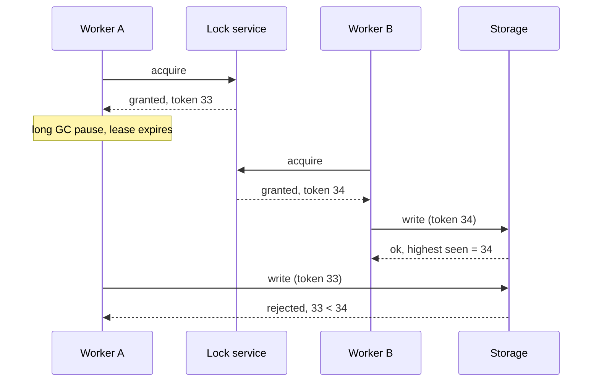

# 32. Distributed locks and fencing tokens
_Sent 2026-10-31_

**The problem.** Several workers must not do the same thing at once: only one should compact a file, run the nightly billing job, or write to a shared object. On one machine you grab a mutex. Across machines you need a lock service, and the network, clocks, and GC pauses make "I hold the lock" a much weaker statement than it sounds.

**Why a lease alone isn't enough.** Distributed locks are almost always leases: you hold the lock for N seconds and must renew it, so a crashed holder can't block everyone forever. But a holder can be paused (a long GC, a VM migration, a slow disk) past its lease without knowing it. The lock service hands the lock to someone else, then the first holder wakes up and writes anyway. Now two "owners" are writing, and the lock did nothing.

**The fix: fencing tokens.** Every time the lock is granted, the lock service returns a number that only goes up. The holder sends that token with every write, and the *storage* remembers the highest token it has seen and rejects anything lower. Safety moves from "the client believes it holds the lock" to "the resource refuses stale writers."

**Where the tokens come from.** You need a lock service built on consensus so the counter is linearizable. ZooKeeper's znode version or zxid, etcd's revision numbers on a key, and a monotonically increasing row in a strongly consistent database all work. A single Redis instance with `SET key val NX PX 30000` is fine as an efficiency lock (avoid doing duplicate work most of the time) but gives you no safe token if it fails over.

**Real-world example.** Google's Chubby paper (Burrows, OSDI 2006) already had this idea: a lock holder can request a "sequencer," an opaque string with the lock name, mode, and a generation number, and pass it to servers, which check it's still current before acting. In 2016 Martin Kleppmann's post "How to do distributed locking" used the GC-pause scenario above to argue that Redis's multi-node Redlock algorithm is unsafe for correctness, partly because it relies on timing assumptions and produces no fencing token. Antirez (Redis's creator) published a rebuttal, and the debate is still the best short read on the topic.

**Tradeoffs and failure modes.**
- **Efficiency vs correctness locks.** If a rare double run just wastes compute, a cheap Redis lock is fine. If it corrupts data or double charges, you need consensus plus fencing, or better, an idempotent operation that doesn't need a lock at all.
- **The resource must cooperate.** Fencing only works if storage checks the token. Many systems (a third-party API, a plain file on S3) can't, so you fall back to conditional writes such as compare-and-set on a version or ETag.
- **Lease length.** Short leases recover fast from crashes but cause false expirations under load; long leases mean long stalls when a holder dies.
- **Clock assumptions.** Leases assume clocks advance at roughly the same rate. Clock jumps or drift shrink your real safety margin.
- **Lock service availability.** A consensus-backed lock service becomes a dependency on your critical path; if its quorum is down, nobody makes progress.

**Try this.** You run a nightly job that reads a customer's usage and writes an invoice into a Postgres table and also calls Stripe to charge the card. Two schedulers might both start it. Where do you put the lock, what plays the role of the fencing token for the Postgres write, and what protects the Stripe call, which can't check your token?
