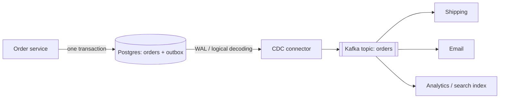

# 33. The dual-write problem: transactional outbox and change data capture
_Sent 2026-11-01_

**The problem.** A service saves an order to its database and then publishes `OrderPlaced` to Kafka so shipping, email, and analytics can react. That's two writes to two systems with no shared transaction. If the process crashes between them, the order exists but nobody hears about it. If you publish first and the DB write fails, downstream ships an order that doesn't exist. Retries don't save you, because you can't tell which half landed. This is the dual-write problem, and "just do both carefully" doesn't fix it.

**The fix: make the database the only write.** Turn the second write into a consequence of the first.

- **Transactional outbox.** In the *same* DB transaction as the order, insert a row into an `outbox` table (event id, aggregate id, type, payload). Either both commit or neither does. A separate relay then reads the outbox and publishes to the broker, marking rows sent or deleting them.
- **Change data capture (CDC).** Instead of polling the outbox, tail the database's own replication log (Postgres WAL through logical decoding, MySQL binlog) and turn committed changes into events. You can CDC the outbox table, which is the common pairing, or CDC the business tables directly.

**Real-world example.** Debezium is the widely used open-source CDC tool: it runs as Kafka Connect connectors that read the MySQL binlog or Postgres WAL and emit one event per row change, and it ships an "outbox event router" transform built specifically for this pattern, routing outbox rows to topics by aggregate type. Before Debezium, LinkedIn built Databus (described in a SoCC 2012 paper) to stream changes from its primary databases to search indexes, caches, and the social graph, for the same reason: application code writing to the DB *and* to each downstream system kept drifting out of sync.

**Tradeoffs and failure modes.**
- **At-least-once, always.** The relay can publish and crash before recording that it did, so events will sometimes be duplicated. Consumers must be idempotent, keyed on the event id (lesson 11 comes back).
- **Ordering is per key, not global.** Partition the topic by aggregate id so all events for one order stay in order. Across orders, don't assume anything.
- **Polling vs log tailing.** A polling relay is simple and works on any database, but adds latency and query load on a hot table. Log tailing is near real time and cheap for the DB, but it's more infrastructure, and it's tied to replication internals.
- **Replication slots can hurt the primary.** In Postgres, a logical slot holds WAL until the consumer confirms it. If the CDC connector stalls for hours, WAL piles up and can fill the primary's disk. Alert on slot lag.
- **CDC on raw tables leaks your schema.** Every column rename becomes a breaking change for consumers. The outbox gives you an explicit, versioned event contract instead.
- **Outbox cleanup.** The table grows forever unless you delete or partition sent rows.
- **Snapshots.** A new consumer needs existing state, not just future changes. CDC tools do an initial snapshot, then switch to the log, and the handoff has to avoid gaps.

**Try this.** Your product search index (Elasticsearch) must reflect price changes within 5 seconds, and price updates come from three services that all write to the same Postgres `products` table. Would you CDC the `products` table directly or have each service write an outbox event? How do you make sure an older price event arriving late never overwrites a newer one in the index, and what happens to the index when you rebuild it from scratch?
