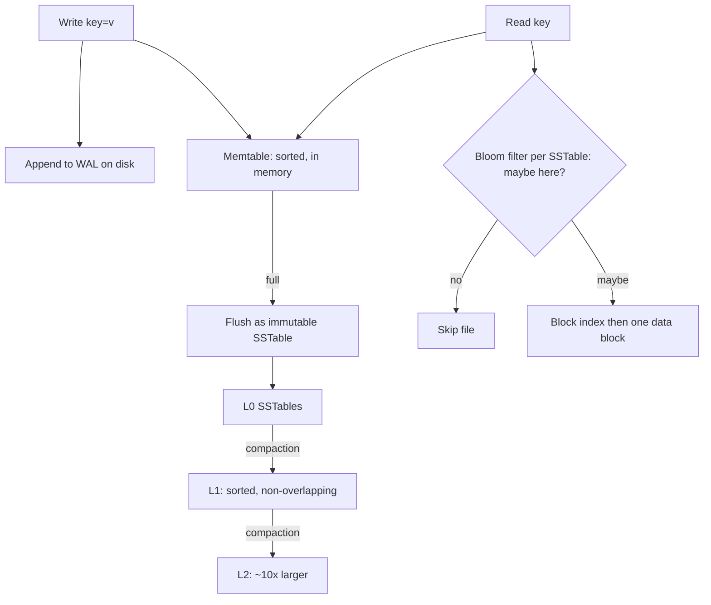

# 34. Storage engines: LSM trees vs B-trees
_Sent 2026-11-02_

**The problem.** Every database you've designed with in this series sits on a storage engine, and that engine decides what a write actually costs on disk. There are two dominant designs. A B-tree (Postgres, MySQL InnoDB) updates pages in place: find the leaf page, modify it, write it back. A log-structured merge tree, or LSM tree (RocksDB, LevelDB, Cassandra, Bigtable/HBase, ScyllaDB), never updates in place: it buffers writes in memory, flushes them as immutable sorted files, and merges those files in the background. Picking between them is really picking which of three costs you want to pay: write amplification, read amplification, or space amplification.

A word on those three, since they drive everything below. **Write amplification** is how many bytes the engine writes to disk per byte you asked it to store. **Read amplification** is how many disk reads a single logical read costs. **Space amplification** is how much more disk the data occupies than its logical size. No engine wins all three; each design trades one for the others.

**How an LSM write and read work.**

- **Write:** append to the write-ahead log for durability, insert into the memtable, done. Sequential I/O only, which is why LSMs absorb heavy write load so well.
- **Flush:** when the memtable fills, it's written out as a sorted string table (SSTable). Updates and deletes are just newer entries; a delete is a tombstone.
- **Read:** check the memtable, then SSTables newest to oldest. Bloom filters let you skip files that definitely don't hold the key, so a point lookup usually touches one or two files. Range scans are worse, since they have to merge across levels.
- **Compaction:** background merging that drops overwritten values and tombstones and keeps the number of files bounded. This is where the real cost lives.

**Real-world example.** Facebook moved its main MySQL social-graph tier (UDB) from InnoDB to MyRocks, MySQL on top of RocksDB. Their engineering posts from 2016 reported MyRocks using roughly half the storage of compressed InnoDB, plus much lower write amplification, which mattered for flash wear and for fitting more data per server. The idea itself goes back to O'Neil et al.'s 1996 LSM-tree paper and became mainstream through Google's Bigtable (OSDI 2006), whose SSTable and memtable design LevelDB and then RocksDB inherited.

**A second example: Uber's Postgres to MySQL write amplification (2016).** Even among B-trees, write amplification bites. Uber wrote about leaving Postgres for MySQL/InnoDB. The core issue: Postgres's MVCC gives every row version a physical location (`ctid`), and *every* index stores that location, so updating a single indexed field creates a new row version and therefore new entries in *every* index, even indexes on columns that didn't change. That amplified writes and replication traffic. InnoDB instead stores the primary key (not a physical address) in secondary indexes and updates rows in place, so only indexes on changed columns are touched. The lesson generalizes past the vendor fight: how an engine represents row versions and index pointers determines its write amplification, which is exactly the axis LSM versus B-tree also turns on, so "which engine" should start from your write pattern, not brand loyalty.

**Compaction strategies are the knob.**
- **Leveled** (RocksDB and LevelDB default): each level is about 10x the previous, files in a level don't overlap. Reads and space are tight, but a byte may be rewritten roughly once per level, so write amplification is high (often 10x to 30x).
- **Size-tiered** (Cassandra's long-time default): merge similarly sized files together. Much less rewriting, but a key can live in many files and a big compaction can temporarily need double the disk space.

**Tradeoffs and failure modes.**
- **B-tree strengths:** predictable reads (a few page hops), good range scans, mature in-place transactional locking. Costs: random writes, page splits, fragmentation, and rewriting a whole page (often 8 to 16 KB) to change a few bytes.
- **LSM strengths:** fast sequential writes, better compression because files are immutable and dense. Costs: read amplification on misses and ranges, and compaction competing with foreground traffic for I/O.
- **Compaction debt:** if writes outpace compaction, L0 piles up and RocksDB deliberately slows or stalls writes. That's backpressure from (lesson 30), built into the engine. Watch pending compaction bytes, not just latency.
- **Tombstone trouble:** deletes are writes. Delete-heavy queues in Cassandra famously slow reads as scans wade through tombstones until compaction clears them after the grace period.
- **Index write amplification:** as Uber found, a single logical update can touch many indexes; fewer, well-chosen indexes cut write cost on both engine families.
- **Tail latency:** a large compaction can spike p99 even when averages look fine. Rate-limit compaction I/O and leave disk headroom.
- **Rule of thumb:** write-heavy, append-mostly, point-lookup data (events, metrics, messages, time series) leans LSM. Read-heavy OLTP with range queries and lots of in-place updates leans B-tree.

**When to use which.** Choose an LSM engine for write-heavy, append-mostly workloads where you ingest far more than you read back, and where point lookups (helped by Bloom filters) dominate over big range scans: metrics, logs, messages, time series, event stores. Choose a B-tree for read-heavy transactional workloads with frequent in-place updates and range queries, and where predictable read latency matters more than peak write throughput. Either way, tune the number of indexes and, for LSMs, the compaction strategy to your actual read/write/space tradeoff rather than accepting defaults blindly.

**Try this.** You're storing per-device telemetry: 2 million devices, one small reading each every 10 seconds, kept for 30 days. Queries are "last hour for device X" and occasionally "all devices in region R right now." Pick a storage engine and justify it, design the key so the common query is one range scan, choose a compaction strategy, and explain how you'd expire 30-day-old data without generating a storm of tombstones. (Hint: think about time-bucketed files you can drop whole.)
