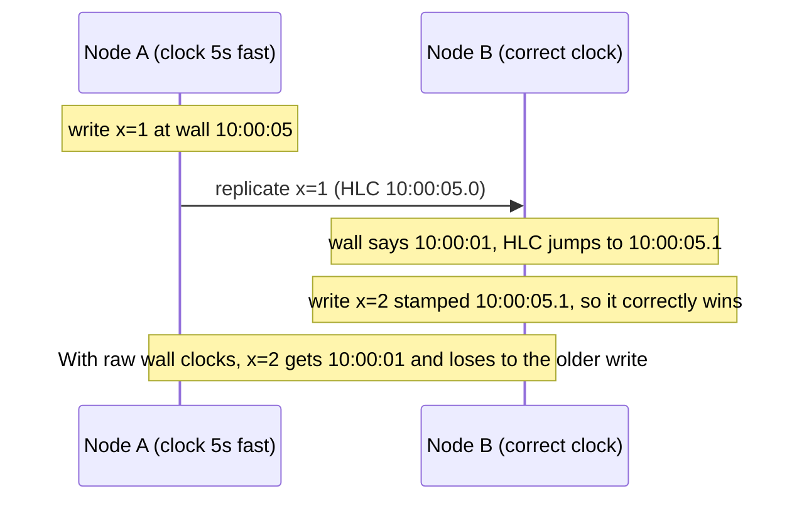

# 35. Time and ordering: wall clocks, Lamport clocks, HLC, and TrueTime
_Sent 2026-11-05_

**The problem.** Lots of designs in this series quietly assumed you can tell which of two events happened first: last-write-wins in a cache, "newest version" in replication, lease expiry, log ordering. On one machine that's easy. Across machines it isn't, because every server's wall clock drifts, NTP corrects it in jumps or slews, and a clock can even go backwards. If two nodes stamp writes with their local time, a write that really happened later can carry an earlier timestamp and silently lose. This lesson is about the tools for ordering events when you can't trust clocks.

**The four tools, from cheapest to strongest.**

- **Wall-clock timestamps.** Good enough for logs and dashboards. Dangerous for deciding which write wins, because skew of even a few milliseconds reorders close-together writes, and a node with a bad clock can "win" every conflict.
- **Lamport clocks** (Lamport, 1978). Each node keeps a counter, bumps it on every event, sends it with every message, and on receive sets `counter = max(local, received) + 1`. This guarantees that if A caused B, A's number is smaller. It doesn't go the other way: smaller doesn't mean "caused", and two unrelated events get an arbitrary order.
- **Vector clocks.** One counter per node, so you can tell "A happened before B" apart from "A and B were concurrent". That's how you detect conflicts instead of hiding them. Amazon's Dynamo paper (2007) used them and handed concurrent versions back to the application to merge. Cost: the vector grows with the number of writers.
- **Hybrid logical clocks (HLC)** (Kulkarni et al., 2014). A timestamp that stays close to physical time but also carries a logical counter, so it never goes backwards and still respects causality. You get timestamps humans can read plus Lamport-style guarantees in a fixed 64-ish bits.

**Real-world example.** Google Spanner (OSDI 2012) took the opposite route: make physical time trustworthy enough to use. Its TrueTime API, backed by GPS receivers and atomic clocks in each datacenter, doesn't return a time, it returns an interval `[earliest, latest]` guaranteed to contain the true time. The paper reports the uncertainty usually sitting in single-digit milliseconds. On commit, Spanner picks a timestamp and then does a "commit wait": it holds the transaction until TrueTime says that timestamp is definitely in the past. That short wait buys external consistency, meaning if transaction T1 commits before T2 starts anywhere in the world, T1 gets the smaller timestamp. CockroachDB, without atomic clocks, uses HLC instead plus a configured maximum clock offset; reads that land inside the uncertainty window get restarted, and a node shuts itself down if it finds its clock drifting too far from its peers.

The cautionary tale: on January 1, 2017, a leap second made Cloudflare's Go-based DNS service see time go backwards. A computed duration came out negative, a function that expected a positive number misbehaved, and some DNS lookups failed. Use a monotonic clock for measuring durations and timeouts, never wall time.

**Tradeoffs and failure modes.**
- **Last-write-wins on wall clocks loses data silently.** Cassandra resolves conflicts this way by default; a client or node with a skewed clock can overwrite newer data, and nobody gets an error.
- **Vector clocks surface conflicts but push merge work onto you.** Siblings pile up if the app never resolves them, and vectors bloat when many clients write directly.
- **HLC bounds, it doesn't eliminate, uncertainty.** If real skew exceeds your configured max offset, the guarantees are gone, so you must monitor offset and fence off bad nodes.
- **TrueTime-style commit wait trades latency for ordering.** Every write pays roughly the uncertainty window, so it only works if that window is kept small with real hardware.
- **Leases and timeouts depend on clock rate, not clock value.** A paused or slow node still believes its lease is valid, which is why lesson 32's fencing tokens exist.

**Try this.** You run a multi-region shopping cart where users can add items from a phone and a laptop at the same time, and each region accepts writes locally. Product says "never lose an added item, but a removed item may occasionally reappear." Which ordering mechanism do you use for cart entries, how do you merge concurrent versions, and what would go wrong if you swapped it for last-write-wins on server timestamps?
