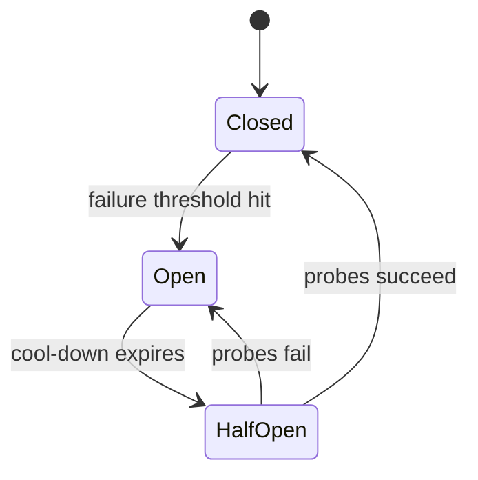

# 36. Circuit breakers and bulkheads
_Sent 2026-11-06_

**The problem.** Lesson 30 was about protecting *your* service when *you* are overloaded. This one is about the other direction: a dependency is sick (payments, recommendations, a cache), and every call into it piles up threads, sockets, and retries until *your* healthy service falls over too. A circuit breaker stops calling a failing dependency for a while. A bulkhead limits how much of your capacity any one dependency can consume, so a fire in one cabin can't sink the ship.

**How a circuit breaker works.** Track recent outcomes for one dependency (or one endpoint of it). Three states:

- **Closed** (normal): calls go through. Count failures (timeouts, 5xx, connection errors — not every 4xx).
- **Open**: after the failure rate or consecutive-failure count crosses a threshold, short-circuit: fail fast locally, don't touch the dependency. Optionally serve a fallback (cached value, default, degraded UI).
- **Half-open**: after a cool-down, let a small probe of calls through. If they succeed, close; if they fail, open again.

A **bulkhead** is the capacity fence around that call path: a dedicated thread pool, semaphore, or connection pool sized for that dependency alone. When the payments pool is full, new payment calls reject immediately — search and cart keep their own pools and stay responsive.

**Real-world example.** Netflix's Hystrix (and its successors Resilience4j and the concurrency-limits work that followed) wrapped every call to a remote service with a circuit breaker plus a bulkhead. When a mid-tier recommendations service degraded, Hystrix opened the circuit and the UI fell back to a cached or default shelf instead of waiting on timeouts. The famous "fail whale" style cascades — one slow dependency saturating every Tomcat thread across the fleet — were exactly what the bulkhead was meant to stop: recommendations got 10 threads per host; checkout got its own 20; a stuck recommendations call could not eat checkout's threads. Amazon's Builders' Library and Google SRE make the same point with different words: isolate failure domains, and prefer a fast local failure over a slow remote one when the dependency's error budget is already burned.

**Tradeoffs and failure modes.**
- **Open too eagerly and you amplify a blip into an outage.** A short timeout spike or a deploy rolling through instances can trip every breaker at once. Use a failure *rate* over a sliding window, require a minimum request volume, and stagger cool-downs (jitter) so the half-open stampede doesn't restart the fire.
- **Fail-open vs fail-closed.** For a non-critical path (recommendations), failing open to a fallback is fine. For authorization or payments, failing closed (deny / error) is usually safer than a silent allow.
- **Fallbacks that lie.** Serving a stale cart total or "in stock" from cache while the inventory service is down can create worse product bugs than an error page. Fallbacks need product sign-off, not just eng convenience.
- **Bulkheads that are too small look like the dependency is down.** Undersized pools reject under normal peak and trip the breaker on your own capacity mistake. Size from measured concurrency × latency, then load-test.
- **Retries bypass the breaker.** A client that retries three times against an open circuit (or against a half-open probe) undoes the protection. Retries belong *inside* the breaker's accounting, with a budget (lesson 30).
- **Health checks that hit the same sick dependency.** If your load balancer marks you unhealthy because a dependency timed out, you shed your own healthy capacity. Probe *your* liveness, not the whole dependency graph.

**Try this.** Your checkout service calls inventory (p99 40 ms), payments (p99 200 ms), and a fraud-score API (p99 800 ms, flaky). Under a fraud-vendor outage, checkout p99 jumps past 5 s and hosts start failing health checks. Design the breaker + bulkhead layout: which calls get breakers, which get fallbacks vs hard errors, how you size each bulkhead, and what you change so a fraud outage cannot take checkout out of the load balancer.
