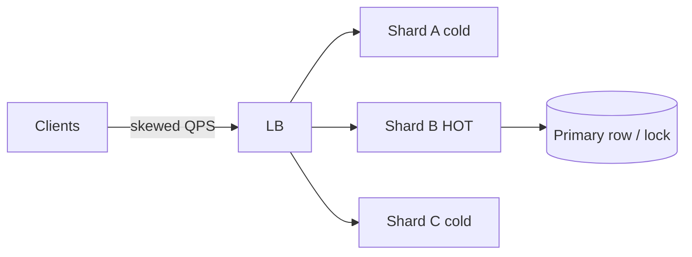

# 37. Hot keys and hotspot mitigation
_Sent 2026-11-07_

**The problem.** You sharded by user id, put a cache in front, and the fleet still melts on one key: a celebrity's profile, a flash-sale SKU, a popular config row, or a single partition that absorbed a viral event. Average load looks fine while one shard, one cache node, or one lock holder takes orders of magnitude more traffic than its neighbors. A hot key is not "too much traffic" in general; it is skew so extreme that capacity math for the average case stops predicting what fails.

**How it shows up.** Hash sharding spreads *keys*, not *bytes or QPS*. If one key is 1% of keys but 40% of reads, that shard (or that Redis slot) is the bottleneck. Writes make it worse: a counter everyone increments, a leaderboard everyone updates, or a row everyone `SELECT ... FOR UPDATE`s. Caching helps reads until the key expires or is invalidated and every client stampedes the origin at once.

**Mitigations that actually work.**
- **Cache with jittered TTLs and single-flight.** Serve the hot key from a local or near cache; on miss, only one request refills (request coalescing / "singleflight") so expiry does not recreate the hotspot. Jitter TTLs so many hot keys do not expire together (lesson 1).
- **Replicate the hot value.** For read-heavy keys, keep N copies (local in-process cache, regional replicas, or fan-out the key onto several cache slots with a random suffix and read any). Writes become "update all copies" or "invalidate all," which is fine when reads dominate.
- **Split the key.** Counters and rate windows shard into `key#0 ... key#N` and sum on read. Leaderboards and feeds often split by time bucket or by audience segment so no single row owns the spike.
- **Isolate the hotspot.** Move the celebrity key or flash SKU onto dedicated capacity (its own shard, its own cache cluster, or a static/CDN path) so it cannot crowd out normal tenants.
- **Admit and shed.** Waiting rooms, per-key rate limits, and load shedding (lesson 30) protect the rest of the system when a key simply cannot be scaled further in time.

**Real-world example.** Social networks and commerce sites hit this constantly: a celebrity post or a limited drop concentrates reads on one object id. Twitter/X-style timelines and Instagram-style media caches keep hot objects in multiple layers (edge CDN, regional cache, in-process) with coalesced fills. Flash sales often pre-split inventory into many counter shards and serve a stale-or-approximate remaining count on the product page so the authoritative row is not hit on every page view. The classic write-side pattern is Google App Engine's "sharded counters": because a single datastore entity could take only a handful of writes per second, you spread increments across N counter entities and sum them on read, trading an exact instant total for write throughput.

**A second example: DynamoDB "split for heat" (2019).** DynamoDB shows both what a managed store can and cannot do about hot keys. Its adaptive capacity, extended in November 2019 to isolate frequently accessed items automatically, detects an imbalanced workload and rebalances partitions so hot items land on their own partition instead of sharing one ("split for heat"). That handles a hot *partition* for you. But it cannot conjure more throughput for a single hot *item*: one atomic counter row is still served by one partition, and splitting a collection by sort key is blocked when local secondary indexes exist. The lesson is the boundary line every designer should internalize: the datastore can rebalance ranges and partitions, but "one popular key" remains an application-level problem you solve by splitting, replicating, or approximating the key, which is why write-sharding your own counters is still necessary even on a fully managed database.

**Tradeoffs and failure modes.**
- **Replicated reads vs write fan-out.** N copies of a hot key cut read latency and load, but every write must touch or invalidate N places. If writers are also hot, you have moved the fire, not put it out.
- **Approximate splits.** Sharded counters are fast and scalable; exact global counts need a gather step or a periodic rollup. Product must accept "about 1.2k left" during the sale.
- **Cache stampedes after invalidation.** A write that deletes the cache key can cause a bigger spike than the write itself. Prefer read-through with single-flight, soft TTLs (serve stale while refreshing), or versioned keys over hard delete-on-write for ultra-hot paths.
- **Detecting the hot key is half the battle.** You can't mitigate what you can't see. Track per-key QPS, lock wait, and partition CPU so a new hotspot trips an alert and a playbook, not an outage.
- **Sticky isolation that never ends.** Dedicating a shard to one key fixes today and creates an ops snowflake tomorrow. Prefer automatic detection plus playbooks over permanent special cases when you can.
- **Locks on hot rows.** Holding a DB row lock or a distributed lock (lesson 32) on a viral key serializes the world. Prefer atomic increments, compare-and-swap on versions, or enqueue updates and apply asynchronously when exact synchronous mutation is not required.

**When to use what.** For a read-hot key, layer caching with single-flight and, if one node still can't serve it, replicate the value across nodes or regions. For a write-hot key (counters, leaderboards, inventory), split it into shards and sum on read, accepting an approximate instant total. Isolate a known, predictable hotspot (a celebrity, a launch SKU) onto dedicated capacity ahead of time, and lean on admission control and shedding only when a key genuinely cannot be scaled in the time you have. Don't rely on a managed datastore's auto-rebalancing to save a single hot item; design the key.

**Try this.** You run a ticketed live event (same world as lesson 28). Seat maps are fine, but the event's `remaining_ga_count` and the artist's profile endpoint each take ~35% of store QPS when onsale starts. Design the key layout and caching so neither key can take down unrelated events: what you split, what you replicate, what may be approximate, and how a write to inventory invalidates or updates copies without a stampede.
