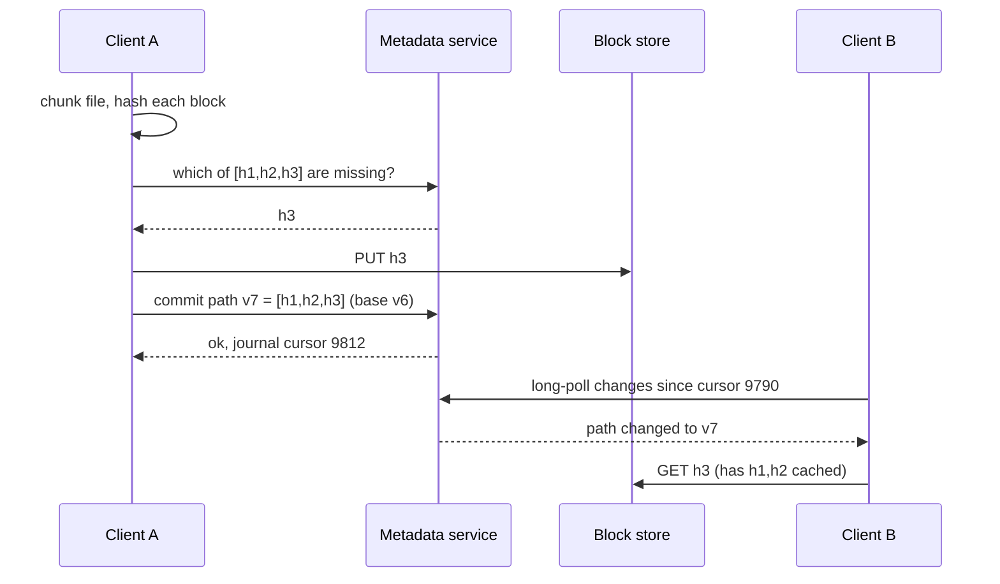

# 38. Case study: file sync (Dropbox-style)
_Sent 2026-11-14_

**The problem.** A user edits a 2 GB video project on a laptop, renames a folder on a phone, and works offline on a plane. Every device must converge on the same tree, uploads must resume after a dropped connection, and you should never store or send the same bytes twice. The naive design (upload the whole file on every save, last write wins on the server) wastes bandwidth and silently loses edits.

**The core split: metadata vs blocks.** Treat a file as an ordered list of content-addressed blocks. Block bytes go to a blob store keyed by their hash, and the metadata service stores only the tree: path, version, and the list of block hashes. A save becomes "hash the blocks locally, ask the server which hashes it lacks, upload only those, then commit the new block list." Unchanged blocks cost nothing, identical files across users dedupe for free, and an interrupted upload resumes at block granularity.

**Sync is a journal, not a scan.** The metadata service keeps an append-only change log per namespace (a user's folder, or a shared folder). Each client stores a cursor and asks "what changed since 9790?" via long-poll or push. That turns sync into tailing a log instead of diffing millions of files, and it is the same idea as CDC from lesson 33.

**Commits are compare-and-set.** The client commits "v7, based on v6." If the server is already at v7 from another device, the commit fails and the client must handle the conflict. File sync systems usually don't merge binary files; they keep both and write a "conflicted copy." That is a product decision as much as a technical one.

**Real-world example.** Dropbox's public API defines its content_hash as SHA-256 over 4 MB blocks, which shows the block model directly. In 2016 Dropbox announced Magic Pocket, its in-house block storage system, after moving the large majority of user data off Amazon S3. Metadata and blocks scale very differently: metadata is small, hot, and transactional, while blocks are huge, immutable, and cold. In 2020 Dropbox wrote about rewriting its desktop sync engine ("Nucleus") in Rust, mainly to make the client-side state model testable. The hard bugs were in reconciling local, remote, and synced state, not in storage.

**Tradeoffs and failure modes**
- **Fixed vs content-defined chunking.** Fixed 4 MB blocks are simple, but inserting one byte at the front shifts every boundary and changes every hash. Content-defined chunking (rolling hash, as in LBFS/rsync-style systems) keeps boundaries stable across inserts. It costs more CPU and gives variable block sizes.
- **Dedup is a side channel.** If "do you already have hash X?" answers across users, an attacker can test whether someone stores a known file. Scope dedup per user or namespace, or require proof of possession.
- **Garbage collection.** Blocks are shared, so deleting a file can't delete its blocks. You need reference counting or mark-and-sweep, plus a grace period so a commit in flight doesn't reference a block GC just removed.
- **The client is half the system.** Watching the filesystem misses events, renames look like delete plus create, case-insensitive filesystems collide (`Readme` vs `README`), and clocks lie (lesson 35). Keep a three-way model on the client (local, remote, last-synced base) so it can tell "I deleted it" from "I never had it."
- **Moves and shared folders.** Moving a 100k-file folder must be one metadata operation, not 100k. That pushes you toward stable file IDs with parent pointers rather than full paths as keys.
- **Hot namespaces.** One huge shared team folder can become a hot key (lesson 37) for the change journal and its fan-out of notifications.

**Try this.** Design sync for a shared team folder of 2 million files and 500 members, where 30 people are online at once and one member renames the top-level folder while another is offline editing a file inside it. What is your primary key for a file (path or ID)? What does the offline client's commit look like when it reconnects, and how many change-journal entries did the rename create?
