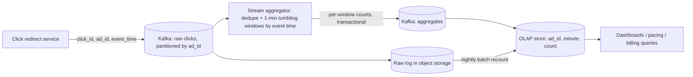

# 39. Case study: ad click aggregation (streaming counts you can bill on)
_Sent 2026-11-21_

**The problem.** Advertisers pay per click, so you need per-ad click counts per minute: near real time for dashboards and budget pacing ("stop serving this campaign, it hit its daily cap"), and exact enough to invoice. Say 10B clicks/day, about 115k/s on average and several times that at peak. The naive design, `UPDATE ads SET clicks = clicks + 1` per click, melts on hot ads (lesson 37), double-counts on retries, and can't answer "how many clicks did ad 42 get between 10:03 and 10:04" after the fact. The real problem is three things at once: high-volume ingest, correct time windows, and counting each click exactly once.

**The shape.**

- **Ingest:** the click redirect service assigns a unique `click_id` and records `event_time` at the edge, then appends to a log partitioned by `ad_id`. Writing the raw event first means you can always recompute.
- **Aggregate:** a stream job (Flink, Kafka Streams, Dataflow) keeps per-`(ad_id, minute)` counters in local state and emits a row when the window closes. Pre-aggregating turns 115k writes/s into one row per active ad per minute.
- **Serve:** an OLAP store (Druid, Pinot, ClickHouse) holds the minute rows and rolls them up to hours and days for queries.

**Event time vs processing time.** A phone on a train sends its click 4 minutes late. If you bucket by when the event *arrived*, that click lands in the wrong minute and your billing windows depend on network luck. Bucket by when it *happened*, and you need a rule for when a window is "done". That rule is the **watermark**: the stream's estimate that "no more events older than T are coming." The window for 10:03 fires when the watermark passes 10:04. Events that show up after that are **late**: you either allow a lateness period and emit a corrected count (an update, not a new row), or drop them to a side output for the batch job to pick up. Google's Dataflow model paper (Akidau et al., VLDB 2015) is the clearest write-up of watermarks, triggers, and allowed lateness, and it's what Apache Beam implements.

**Exactly once, honestly.** Every hop retries, so the default is at-least-once. Two pieces make the *result* exactly-once:
1. **Dedupe on `click_id`** (lesson 11). Keep seen IDs in keyed state with a TTL a bit longer than your lateness window. A user double-tapping an ad produces two events with different IDs; that's a fraud/validity rule, not dedupe.
2. **Atomic state + output.** Flink snapshots operator state with checkpoint barriers and, with a transactional sink (Kafka transactions, added in Kafka 0.11 in 2017), commits the output only when the checkpoint commits. A crash rolls back to the last checkpoint and replays input without double-emitting. "Exactly-once" here means the effect on state and output, not that each event is processed once.

**Real-world example: Google Photon.** Google's ads pipeline has to join each click with the query/ad-serving event that produced it, across datacenters, before anyone can bill. Photon (Ananthanarayanan et al., SIGMOD 2013) does that join continuously and guarantees each click is joined at most once, even with workers in multiple datacenters processing the same click. Its trick is a shared **IdRegistry** replicated with Paxos: before emitting a joined click, a worker must register its `click_id` there; whoever registers first wins, and duplicates are dropped. It's lesson 11's idempotency key, made global with lesson 13's consensus.

**Tradeoffs and failure modes.**
- **Freshness vs completeness.** A short watermark delay gives fast dashboards and more late corrections; a long one gives stable numbers that lag. Many systems show a "provisional" real-time number and invoice from a later, settled one.
- **Stream vs batch truth.** The Lambda architecture (stream for fast, nightly batch for correct) works but means two codebases that can disagree. Kappa (Jay Kreps, 2014) says keep one streaming job and reprocess by replaying the log. Either way, keep the raw log so you can recount.
- **Hot ads.** Partitioning by `ad_id` puts a Super Bowl ad on one partition. Pre-aggregate per worker (or split the key into `ad_id#N`) and merge downstream.
- **Dedupe state size.** Billions of IDs per day in keyed state is real memory. A TTL bounds it; a Bloom filter shrinks it but adds false-positive drops, which is undercounting you'll bill wrong on.
- **Watermark stalls.** One idle or lagging partition holds the global watermark back and windows stop firing. Mark idle sources, and alert on watermark lag, not just consumer lag.
- **Reconciliation.** Run a batch recount from the raw log and alert when it differs from the stream by more than a threshold. Disagreement is how you find the bugs above.

**Try this.** Add **budget pacing**: an advertiser sets a $5,000 daily cap, and you must stop serving their ads within about 30 seconds of hitting it, across 50 ad-server regions. Where does the running spend live, and is it read from your 1-minute aggregates or something faster? How much overspend do you accept, and how do you bound it when a region is partitioned from the counter? What happens to the clicks that arrive after you stopped serving but were caused by impressions shown before?
