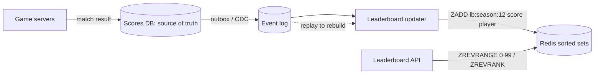

# 40. Case study: a real-time leaderboard (top-K and "what's my rank?")
_Sent 2026-11-28_

**The problem.** A game with 50M players wants a live leaderboard: show the top 100, and show *each* player "you're #1,284,991" right after a match. The obvious SQL, `SELECT COUNT(*) FROM scores WHERE score > :mine`, is a range scan over millions of rows per request, and `ORDER BY score DESC LIMIT 100` fights every write for the same index pages. Top-K is easy; **rank for an arbitrary player at high write rates** is the actual problem.

**The shape.**

- **Source of truth** stays in a durable store. The leaderboard is a *derived view* you can rebuild by replaying the log (lesson 33's outbox/CDC).
- **Redis sorted set** (`ZADD`, `ZREVRANGE`, `ZREVRANK`) keeps members ordered by score. Internally it's a skip list plus a hash table, so updates and rank lookups are O(log N) and the top 100 is O(log N + 100). At roughly 100 bytes per entry, 50M players is a few GB: one node, with a replica.
- **Time-scoped boards** are just more keys: `lb:daily:2026-11-28` with an `EXPIRE`, and weekly built by `ZUNIONSTORE` over the dailies.

**Ties.** Redis scores are doubles, and equal scores are ordered by member name, which is rarely what you want ("whoever got there first wins"). The usual fix is a composite score: `score * 2^k + (MAX_TS - achieved_at)`, so earlier achievers sort higher. Doubles hold integers exactly only up to 2^53, so budget the bits: a 32-bit score leaves about 21 bits for the tiebreaker, which means coarse time buckets, not milliseconds.

**When one node isn't enough.** Two ways to shard, and they trade opposite things:
- **Hash by player.** Writes spread evenly. Top 100 = ask each shard for its top 100, merge (scatter-gather). Global rank = sum of `ZCOUNT(score, +inf)` across all shards: correct, but every rank query hits every shard.
- **Range by score.** Rank = (players in higher shards, from a cached count) + local rank: one shard. But the score distribution is skewed, the top shard is tiny and hot, and players migrate between shards as they improve, so you're constantly rebalancing.

At very large N, most products stop promising exact ranks below the top few thousand. Keep exact sorted sets for the head, and for everyone else keep a **histogram of score buckets**: rank ≈ players in higher buckets + position inside your bucket. "Top 3%" is honest, cheap, and nobody can tell #1,284,991 from #1,285,040.

**Real-world example.** AWS publishes a reference design for exactly this ("real-time gaming leaderboard with Amazon ElastiCache for Redis"): game events update sorted sets, the API serves `ZREVRANGE`/`ZREVRANK`, and a durable database keeps the record. Redis's own docs list leaderboards as the canonical sorted-set use case. The skip list underneath comes from William Pugh's 1990 CACM paper, picked over balanced trees because it's simpler to implement and supports range walks naturally.

**Tradeoffs and failure modes.**
- **Cache as truth.** If Redis is the only copy, a failover with async replication (lesson 6) silently loses recent scores. Keep the durable log and make rebuilds routine, not heroic.
- **Out-of-order updates.** Two match results for one player race through the updater; the older one lands last and lowers the score. Use `ZADD ... GT` (only raise) for "best score" boards, or carry a version and check it.
- **Hot reads at season end.** Everyone loads the top 100 at once. Cache that page for a second or two at the edge (lesson 37); it doesn't need to be live to the millisecond.
- **Big key deletes.** Dropping a 50M-member set blocks Redis. Use `UNLINK` (async free) or let `EXPIRE` handle old seasons.
- **Cheating.** The leaderboard makes fraud visible and valuable. Validate scores server-side before they ever reach the updater, and keep a way to remove a player and recompute.

**When to use what.** One Redis sorted set per board, fed from a durable log, covers the vast majority of games and apps up to tens of millions of players. Hash-shard only when write rate or memory forces it, and accept scatter-gather for rank. Switch to exact-head plus approximate-tail when N gets big enough that exact rank costs more than it's worth to the user.

**Try this.** Add a **friends leaderboard**: each player sees their rank among their own friends (median 150, max 5,000), updated live. Do you precompute a sorted set per player (and how many writes does one score change fan out to?) or compute on read from the friend list plus the global set? Where's the crossover, and how do you handle a celebrity account with 5,000 friends who all play daily?
